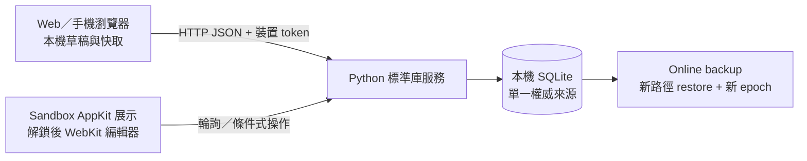

# 架構：目前程式與 1.0 設計邊界

更新：2026-10-04。產品語意以 [SPEC-003](specs/003-desktop-cards-groups-and-formation.md)
與 [ADR-006](decisions/006-card-group-and-formation-semantics.md) 為準；正式技術選型尚未完成。

## 1.0 的責任分界

使用者已確定一事一卡、群組、顯式 formation、單組／全組操作與拖放轉組。
Google 帳號＋檔案來源、沒有自家便箋 local server 的方向維持。
不能從舊版「純文字便箋」草案省去今天已確認的互動。

- 共用 Card/Group 是穩定資料身分；不以原生視窗或機器取代群組。
- 位置、尺寸、基本疊序、grid、undo 為每機資料；scope、focus、拖曳目標是暫態。
- FormationPlanner 產生可預覽計畫，再明確提交；同步、輪播、新增都不能自行呼叫全局排版。
- InteractionController 處理單擊／雙擊／拖動／Shift／取消，轉組送出條件式資料命令。
- Renderer 負責卡片間排序、微亮與目標判定；來源不直接接 native window。
- Host 提供具體能力：桌面／浮層、輸入區域、焦點、螢幕及快捷鍵 backend。

[ADR-007](decisions/007-desktop-scene-and-platform-host.md) 提议少量共同繪製表面及平台 adapter。
尤其 Wayland，同層多個獨立 surface 的排序未定義，不能以一卡一原生視窗保證群組輪播。
這是選型限制，並未決定所有平台必須使用同一 framework 或相同視窗數。
參見 [平台研究](resreach/2026-10-04-desktop-interaction-platform-feasibility.md)。

## 來源、backup 與後續擴充

[ADR-004](decisions/004-google-drive-notes-mvp.md) 保留 NoteSource、檔案型 adapter 與 Drive appDataFolder 提案。
正式同步協定須納入共享群組 metadata、引用、歸屬衝突，不能只同步本文。
每台裝置多個呈現表面共用一份本機核心與同步協調，不為每張卡各自建立來源連線。

BackupService 屬於共用核心，不由 Drive 或 renderer 私自定義格式。
[SPEC-002](specs/002-portable-backup-and-restore.md)／[ADR-005](decisions/005-portable-backup-and-restore.md)
是待修訂提案；ZIP／JSON、新 ID 匯入、版面與附件等範圍尚未全部批准。
備份必須保留最終共用卡片／群組語意；未知內容不能靜默丟棄後宣稱成功。

[完整 PM／server 草案](resreach/2026-10-03-product-architecture-blueprint.md) 與 ADR-003 保留為 Deferred。
其中 Note 容器的模型不再規範 1.0；未來採用也須重新對齊一事一卡。
施工順序見 [PLAN-003](plans/003-desktop-interaction-implementation.md) 與修訂後 [PLAN-002](plans/002-google-drive-notes-mvp.md)。

## 0.1.0 驗證版架構

更新：2026-10-03。採用範圍與選擇理由見 [ADR-002](decisions/002-validation-runtime.md)。

- `src/server/work_fleet.py`：交易、revision／epoch、idempotency、tombstone、裝置／邀請、備份恢復及同 origin HTTP。
- `src/web/`：原生 ES modules，輸入即保留草稿；網路失敗不覆蓋使用者文字。每次取回草稿建立獨立 record。
- `src/macos/main.swift`：公開 AppKit window level／mouse／focus 政策、Foundation 輪詢、CoreImage QR。
- 鎖定顯示原生文字，解鎖使用相同 Web UI。WebView 在重新鎖定時保持存活；換來源先鎖定並移除旧 editor。
- notes 的 board 是簡單群組；所有內容可共享，沒有 Agent 執行狀態、排程或分派。

SQLite 不放共享網路磁碟。不同項目可各自寫入；同項目更新以整筆 revision 檢查，
即使不同欄位也可能回衝突，避免假設可安全自動合併。操作紀錄和 tombstone 本版不自動清除。
全量輪詢適合小型驗證資料，尚未實作增量同步或大資料效能調校。

本機突出及 SPEC-003 的多卡片互動尚未實作；目前以一個可調整大小的桌面面板展示多筆便箋。
正式產品不預設一卡一個原生視窗，其拓撲依 ADR-007 另定。
Windows/Linux/iOS/Android 仍透過相同 HTTP 契約保留後續原生整合與商店目標。
