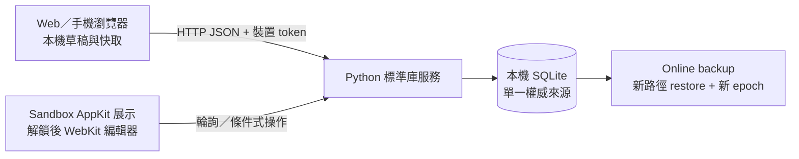

# 架構：驗證版現況與正式產品設計

## 目前優先：正式架構

使用者要求先做好架構，多便箋視窗與 Mac 桌面實測留到後續整合階段。
詳見 [正式產品架構草案](resreach/2026-10-03-product-architecture-blueprint.md) 與
[ADR-003（Proposed）](decisions/003-product-architecture-boundaries.md)。

建議以獨立 Item／Note／View、單一 client 同步核心及平台 adapter 為邊界；
正式 framework 與 server runtime 尚未因本提案而定案。以下保留可執行 0.1.0 的實際架構。

## 0.1.0 驗證版架構

更新：2026-10-03。採用範圍與選擇理由見 [ADR-002](decisions/002-validation-runtime.md)。

- `src/server/work_fleet.py`：交易、revision／epoch、idempotency、tombstone、裝置／邀請、備份恢復及同 origin HTTP。
- `src/web/`：原生 ES modules，輸入即保留草稿；網路失敗不覆蓋使用者文字。每次取回草稿建立獨立 record。
- `src/macos/main.swift`：公開 AppKit window level／mouse／focus 政策、Foundation 輪詢、CoreImage QR。
- 鎖定顯示原生文字，解鎖使用相同 Web UI。WebView 在重新鎖定時保持存活；換來源先鎖定並移除旧 editor。
- notes 的 board 是簡單群組；所有內容可共享，沒有 Agent 執行狀態、排程或分派。

SQLite 不放共享網路磁碟。不同項目可各自寫入；同項目更新以整筆 revision 檢查，
即使不同欄位也可能回衝突，避免假設可安全自動合併。操作紀錄和 tombstone 本版不自動清除。
全量輪詢適合小型驗證資料，尚未實作增量同步或大資料效能調校。

本機突出與多張獨立可拖動便箋視窗尚未實作；目前以一個可調整大小的桌面面板展示多筆便箋。
Windows/Linux/iOS/Android 仍透過相同 HTTP 契約保留後續原生整合與商店目標。
