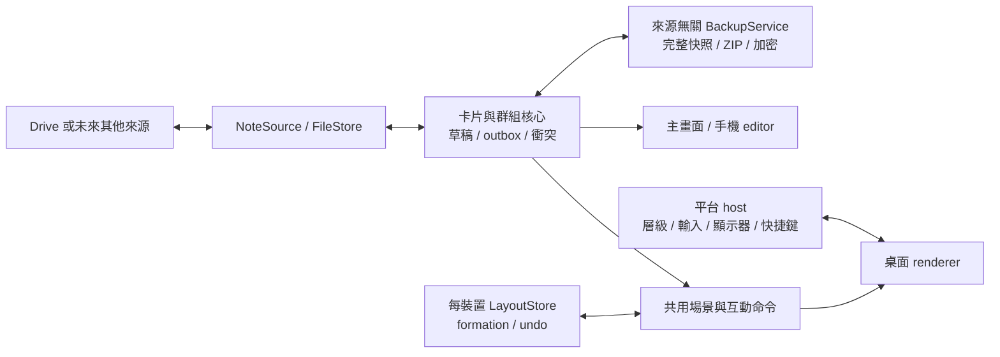
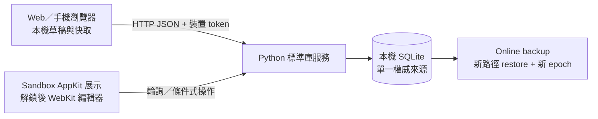

# 架構：目前程式與 1.0 設計邊界

更新：2026-10-04。產品語意以 [SPEC-003](specs/003-desktop-cards-groups-and-formation.md)
與 [ADR-006](decisions/006-card-group-and-formation-semantics.md) 為準；Windows 主畫面／保存選型已由 ADR-015 接受，其他平台及桌面呈現持續整合。

[ADR-008](decisions/008-portable-interaction-core.md) 已定案共用 ES modules 語意核心：
`src/core` 保存卡片／群組／草稿／outbox，`src/layout` 計算及保存每機排列，
`src/interaction` 控制操作範圍與手勢。轉組的共享命令與 geometry 在同一本機交易提交。
`contracts/desktop.d.ts` 定義可替換 persistence／source／host 的邊界；
`src/app` 與 IndexedDB adapter 已加入；選擇與限制見 [ADR-009](decisions/009-local-renderer-and-persistence.md)。
Windows 原生落盤 adapter 與主畫面見 [ADR-015](decisions/015-windows-native-storage-and-editor-host.md)；
其他平台、實際 Google 與完整桌面矩陣尚需後續整合，不以瀏覽器測試宣稱完成。

Windows 場景經 [ADR-018](decisions/018-single-owner-desktop-views.md) 接到同一份 Workspace／InteractionController。
`src/desktop` 發布純呈現投影與受控命令，Windows 每顯示器分桌面／浮動表面；沒有第二個 Workspace。
native memory mailbox 只傳 frame／命令，不能存取資料庫、附件或 vault。
草稿獨立序列支援退出保存屏障，換 view／失聯／關閉先完成已接受寫入；管理視窗 resize 不再觸發桌面救援。
全域快捷鍵與系統匣依 [ADR-019](decisions/019-windows-shortcuts-and-tray.md) 進入同一命令序列。
原生焦點中解除 OS 註冊，本地 handler 保留 IME／editor 優先序；收起主畫面不關閉資料權威。

[SPEC-004](specs/004-revision-graph-and-file-sync.md)／[ADR-011](decisions/011-immutable-revision-graph.md)
定義 `src/sources` 的嚴格 JSON、不可變版本圖、缺 parent 與多 head。
Workspace 已把版本、投影、衝突、群組版面參照與 cursor 接在原子保存邊界，
`src/app/conflicts.js` 提供比較／採用／歷史恢復與群組修復。
[ADR-012](decisions/012-durable-file-store-and-drive-adapter.md) 的 FileSync 協調分頁、持久 reservation、
附件、ack 與退避；GoogleDriveFileStore 實作 REST／resumable。原生授權、受保護 HTTP 及 renderer 連接仍需整合。
[ADR-054](decisions/054-explicit-workspace-initialization.md) 增加 V1 workspace prepare／ready 控制檔：
reset 發起端以 durable journal 清空後初始化，其他副本等待；新帳號可共同完成同一確定性計畫。
Workspace 暫存 incoming，核對 required bytes／附件後原子啟用；ready 的補掃需求與 cursor 同交易持久保存。

[ADR-013](decisions/013-complete-portable-backup.md) 的 `src/backup` 捕獲完整本機快照，
校驗 ZIP／manifest／圖／引用／附件，並提供 WebCrypto 加密容器；驗證不寫目標。
大量版本圖與投影提供可取消的批次 reader，與日常同步共用 graph 規則。
還原交易、自動 journal／排程及 UI 已加入；Windows 原生檔案保存與 vault 見 ADR-016，其他平台另行整合。

Windows `src/native/windows/app` 封裝管理／編輯 WebView2，virtual host 只映射 Assets，不啟動 listener。
`src/native/windows/core` 擁有單一 SQLite／DPAPI coordinator，`src/storage/native.js` 適配共用 persistence。
bridge 僅接受固定資料方法、受限 chunk 與不透明傳輸身分；profile 由 host 指定。
Workspace／receipt／附件共同提交，journal 獨立 CAS；OS vault 沒有 renderer plaintext 讀取入口。
Windows backup adapter 以 DPAPI metadata 綁定 profile／目錄／檔案身分，SQLite schema version 2
保留既有資料並新增 native capabilities。NTFS 子檔相對已持有的目錄 handle 開啟；
create-only、Flush／讀回校驗、同 handle 清理見 [ADR-016](decisions/016-windows-native-backup-files-and-vault.md)。

[ADR-051](decisions/051-schema-evolution-and-atomic-migrations.md) 經維護者修訂：測試階段 Workspace、revision／Drive metadata、
備份／加密 envelope、版面及自動備份 journal 全部維持 V1，版本常數與基本驗證集中在 `core/schema.js`。
欄位直接調整 V1；沒有逐版 runner、啟動升級交易、migration 副本或額外 bridge API。
一般 CAS、草稿、附件、完整備份與帳號隔離照常；SQLite 既有內部表版本不因這項政策重設。
正式上架規劃開始時再評估格式凍結及 migration。
自動備份以 opaque key ID 請 native 產生可攜加密 ZIP，保存密碼不回 renderer；手動密碼留在當次匯出流程。
桌面分層／穿透表面與主畫面共用權威資料，不能各自寫入副本；Windows 已啟用 desktopPresentation。
Windows 原生表面基礎由 [ADR-017](decisions/017-windows-composition-surface-and-input.md) 採納：
每場景一個 CompositionControl、兩個互補 region 的 WPF 表面；共用卡片排序決定输入遮擋。
快捷鍵及 physical monitor 盤點已有獨立類別；控制器、邏輯座標映射及產品入口持續整合。

## 1.0 的責任分界

使用者已確定一事一卡、群組、顯式 formation、單組／全組操作與拖放轉組。
Google 帳號＋檔案來源、沒有自家便箋 local server 的方向維持。
不能從舊版「純文字便箋」草案省去今天已確認的互動。

- 共用 Card/Group 是穩定資料身分；不以原生視窗或機器取代群組。
- 位置、尺寸、基本疊序、grid、undo 為每機資料；scope、focus、拖曳目標是暫態。
- FormationPlanner 產生可預覽計畫，再明確提交；同步、輪播、新增都不能自行呼叫全局排版。
- InteractionController 處理單擊／雙擊／拖動／Shift／取消，轉組送出條件式資料命令。
- Renderer 負責卡片間排序、微亮與目標判定；來源不直接接 native window。
- Host 提供具體能力：桌面／浮層、輸入區域、焦點、螢幕及快捷鍵 backend。

[ADR-007](decisions/007-desktop-scene-and-platform-host.md) 提议少量共同繪製表面及平台 adapter。
尤其 Wayland，同層多個獨立 surface 的排序未定義，不能以一卡一原生視窗保證群組輪播。
這是選型限制，並未決定所有平台必須使用同一 framework 或相同視窗數。
參見 [平台研究](research/2026-10-04-desktop-interaction-platform-feasibility.md)。

## 來源、backup 與後續擴充

[ADR-004](decisions/004-google-drive-notes-mvp.md) 保留初始提案；ADR-012 採納 Drive appDataFolder，
SPEC-004 同步共享卡片／群組及完整分支，不只同步本文。原生 service 的 transport 固定帳號，
token／resumable URL 不進 renderer、Workspace 或備份；可替換介面見 `contracts/sync.d.ts`。
每台裝置多個呈現表面共用一份本機核心與同步協調，不為每張卡各自建立來源連線。

BackupService 屬於共用核心，不由 Drive 或 renderer 私自定義格式。
[SPEC-002](specs/002-portable-backup-and-restore.md)／[ADR-013](decisions/013-complete-portable-backup.md)
定義群組／版面／附件、自動與加密備份，以及匯入／合併／取代還原的現行契約。
[ADR-037](decisions/037-msix-data-lifetime-and-google-backup-overwrite.md) 另定義 MSIX 套件私有資料與解除安裝清除政策，
以及先保存完整本機還原資料、再分持久 reset／upload 階段執行的全量 Google 覆蓋；不是 Drive 多檔案原子交易。
[ADR-038](decisions/038-portable-local-and-cloud-backup-flows.md) 補充同格式雙向遷移、手動 Google 匯出同步及本機原子完整還原。
`prepareLocalRestore` 在空白同 profile 建立計畫，Workspace 提交成功後替換 graph／layout；
同一 SQLite／IndexedDB 交易清除目前本機分區附件並保存完整備份附件集合，其他分區／journal 保留。
全量本機還原前等待自動備份閒置，舊資料安全備份可選；Google 全量覆蓋規則不變。
備份必須保留最終共用卡片／群組語意；未知內容不能靜默丟棄後宣稱成功。
`prepareRestore` 只產生綁定目標 revision 的不可變計畫；Workspace 提交時一起保存附件、
receipt 及新 outbox。`contracts/backup.d.ts` 定義 file adapter／原子 persistence 邊界，
原生保存證明不可由 renderer 任意 JSON 取代。Browser 預覽使用 IndexedDB 及 File System Access。
自動排程使用另一份 profile CAS journal，避免自身保存成為內容變化；具持久 pending／inventory
與 policy generation，詳見 [ADR-014](decisions/014-durable-automatic-backups.md)。
Browser 手動保存可用；自動建立／清理能力明確 unavailable。Windows host 已提供本機 NTFS backend。

[完整 PM／server 草案](research/2026-10-03-product-architecture-blueprint.md) 與 ADR-003 保留為 Deferred。
其中 Note 容器的模型不再規範 1.0；未來採用也須重新對齊一事一卡。
施工順序見 [PLAN-003](plans/003-desktop-interaction-implementation.md) 與修訂後 [PLAN-002](plans/002-google-drive-notes-mvp.md)。

## 0.1.0 驗證版架構

更新：2026-10-03。採用範圍與選擇理由見 [ADR-002](decisions/002-validation-runtime.md)。

- `src/server/work_fleet.py`：交易、revision／epoch、idempotency、tombstone、裝置／邀請、備份恢復及同 origin HTTP。
- `src/web/`：原生 ES modules，輸入即保留草稿；網路失敗不覆蓋使用者文字。每次取回草稿建立獨立 record。
- `src/macos/main.swift`：公開 AppKit window level／mouse／focus 政策、Foundation 輪詢、CoreImage QR。
- 鎖定顯示原生文字，解鎖使用相同 Web UI。WebView 在重新鎖定時保持存活；換來源先鎖定並移除旧 editor。
- notes 的 board 是簡單群組；所有內容可共享，沒有 Agent 執行狀態、排程或分派。

SQLite 不放共享網路磁碟。不同項目可各自寫入；同項目更新以整筆 revision 檢查，
即使不同欄位也可能回衝突，避免假設可安全自動合併。操作紀錄和 tombstone 本版不自動清除。
全量輪詢適合小型驗證資料，尚未實作增量同步或大資料效能調校。

本機突出及 SPEC-003 的多卡片互動尚未實作；目前以一個可調整大小的桌面面板展示多筆便箋。
正式產品不預設一卡一個原生視窗，其拓撲依 ADR-007 另定。
Windows/Linux/iOS/Android 仍透過相同 HTTP 契約保留後續原生整合與商店目標。
