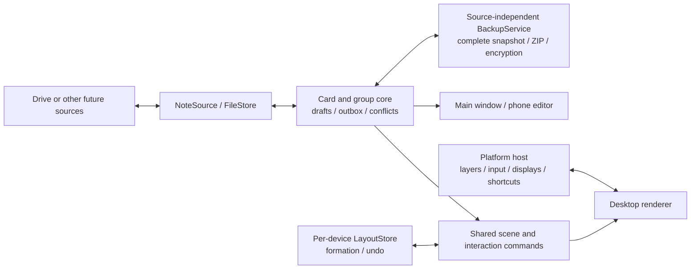
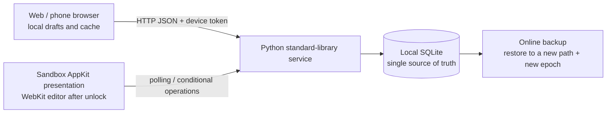

# Architecture: Current Code and 1.0 Design Boundaries

Updated: 2026-10-04. Product semantics follow [SPEC-003](specs/003-desktop-cards-groups-and-formation.md)
and [ADR-006](decisions/006-card-group-and-formation-semantics.md); the Windows main window and storage choice was
accepted by ADR-015, and other platforms and the desktop presentation are still being integrated.

[ADR-008](decisions/008-portable-interaction-core.md) settled the shared ES modules semantic core:
`src/core` stores cards / groups / unsaved changes (`drafts`) / outbox, `src/layout` computes and stores each device's arrangement, and
`src/interaction` controls operation scope and gestures. The shared command and the geometry of a group transfer commit
in the same local transaction.
`contracts/desktop.d.ts` defines the boundary for replaceable persistence / source / host;
`src/app` and the IndexedDB adapter are in place; the choices and limits are in
[ADR-009](decisions/009-local-renderer-and-persistence.md).
The Windows native persistence adapter and main window are in
[ADR-015](decisions/015-windows-native-storage-and-editor-host.md);
other platforms, real Google and the full desktop matrix still need later integration, and browser tests are not used to
claim completion.

Windows scenes connect to the same Workspace / InteractionController through
[ADR-018](decisions/018-single-owner-desktop-views.md).
`src/desktop` publishes pure presentation projections and controlled commands; on Windows each display has a desktop
surface and a floating surface; there is no second Workspace.
The native memory mailbox carries only frames and commands and cannot access the database, attachments or vault.
Unsaved changes have their own sequence that supports an exit save barrier: switching views, a disconnection or closing first
completes the writes already accepted; resizing the management window no longer triggers a desktop rescue.
Every view reads `Workspace.working`, which shows each note's unsaved changes and adds notes never saved; commands
that write revisions read the saved snapshot ([ADR-061](decisions/061-unsaved-changes-instead-of-drafts.md)).
Global shortcuts and the tray enter the same command sequence according to
[ADR-019](decisions/019-windows-shortcuts-and-tray.md).
While native focus is held, the OS registration is released and local handlers keep IME / editor priority; hiding the
main window does not close the data authority.

[ADR-058](decisions/058-desktop-presentation-lifecycle-and-core-isolation.md) proposes moving that authority and
service scheduling out of graphical hosts into a nonvisual resident core, with disposable presentation processes
and continuous availability/recovery under [SPEC-009](specs/009-desktop-presentation-lifecycle.md).
This is a proposed boundary, not the current implementation; the main WebView still assembles the work services.
Runtime selection, process grouping and session handover precede implementation in
[PLAN-009](plans/009-desktop-presentation-lifecycle.md).

[ADR-062](decisions/062-dataset-checkpoints-and-deletable-history.md)/[SPEC-010](specs/010-dataset-checkpoints-and-deletable-history.md)
define the active dataset runtime. `contracts/storage.d.ts`, `src/storage/records*.js` and native SQLite provide
bounded transactions, indexed paging and exact receipts. `WorkspaceRecordStorage` loads only current/meta/draft
records, stores immutable history separately and atomically activates staged bulk generations. Typing persists
only the draft and receipt; history is not copied, encrypted or transferred through the bridge per keystroke.
`DatasetSync` reconciles the fixed checkpoint shards, bounded receipt tail and targeted purge markers, preserving
unknown ancestry as conservative conflicts. Native hosts own OAuth and typed Drive operations. `DatasetHistory`
lists only a selected entity's metadata and hydrates the selected body or attachment. `DatasetPurge` commits a
terminal identity barrier, sanitizes current copies, then cleans owned cloud data and indexed local caches.
`src/app/main.js` schedules one cleanup/seed unit between foreground operations; `src/app/conflicts.js` handles
paged history, conflict resolution and explicit new-identity recovery of unpublished purged-note edits.

`DatasetReset` captures old leaf IDs before publishing its old-format fence and new dataset. Readiness releases
normal sync before exact-ID background cleanup finishes. The incompatible-local screen keeps old profiles intact
until local discard is confirmed separately from Google reset. Missing cloud roots/fences/readiness pause uploads;
rejoin or current-only recovery requires an explicit preview. No migration or automatic resurrection runs.
Legacy FileSync/graph code remains for old-format fixtures and fence verification, not application bootstrap.
Independent protocol review, installed-host and real-Drive acceptance are still required.

The `src/backup` of [ADR-013](decisions/013-complete-portable-backup.md) captures explicitly selected complete retained history or current-only coverage,
validates ZIP / manifest / graph / references / attachments and provides a WebCrypto encrypted container; validation
does not write to the target.
Large revision graphs and projections have a cancellable batch reader that shares the graph rules with daily sync.
Restore transactions, the automatic journal and schedule, and the UI are in place; Windows native file saving and the
vault are in ADR-016, and other platforms are integrated separately.

On Windows, `src/native/windows/app` packages the management and editing WebView2; the virtual host maps only Assets and
starts no listener.
`src/native/windows/core` owns the single SQLite / DPAPI coordinator, and `src/storage/records-native.js` adapts shared record persistence; `src/storage/native.js` supplies transfers and the backup journal.
The bridge accepts only fixed data methods, restricted chunks and opaque transfer identities; the profile is assigned by
the host.
Workspace, receipts and attachments commit together, and the journal has its own CAS; the OS vault has no entry point
for the renderer to read plaintext.
The Windows backup adapter binds profile, folder and file identity with DPAPI metadata; SQLite schema version 2
keeps the existing data and adds native capabilities. NTFS child files are opened relative to a directory handle that
is already held; create-only, Flush and read-back verification, and cleanup through the same handle are in
[ADR-016](decisions/016-windows-native-backup-files-and-vault.md).

[ADR-051](decisions/051-schema-evolution-and-atomic-migrations.md), as revised by the maintainer: during testing, the
Workspace, revision and Drive metadata, backup and encryption envelopes, layout and the automatic backup journal all
stay at V1, with the version constants and basic validation centralized in `core/schema.js`.
Fields change V1 directly; there is no per-version runner, startup upgrade transaction, migration copy or extra bridge
API. Ordinary CAS, drafts, attachments, complete backups and account isolation work as usual; the existing internal
SQLite table versions are not reset by this policy.
Format freezing and migrations are evaluated when formal store-launch planning starts.
Automatic backups ask the native side, by an opaque key ID, to produce a portable encrypted ZIP; the saved password
never returns to the renderer, and a manual password stays within that export flow.
The layered and click-through desktop surfaces share the authoritative data with the main window and cannot each write
their own copy; Windows has enabled desktopPresentation.
The Windows native surface foundation was adopted by [ADR-017](decisions/017-windows-composition-surface-and-input.md):
one CompositionControl per scene and a WPF surface with two complementary regions; the shared card order decides input
occlusion.
Shortcuts and the physical monitor inventory have their own classes; the controller, the logical coordinate mapping and
the product entry points are still being integrated.

## 1.0 responsibility boundaries

The user settled one card per thing, groups, explicit formation, per-group and all-group operation, and group transfer
by drag and drop.
The direction of a Google account plus a file source, without a local note server of our own, stays.
The interactions confirmed today must not be dropped on the basis of the old "plain-text notes" draft.

- The shared Card/Group is the stable data identity; native windows or machines do not replace groups.
- Position, size, base stacking order, grid and undo are per-device data; scope, focus and drag target are transient.
- FormationPlanner produces a plan that can be previewed and is then committed explicitly; sync, cycling and adding a
  card must never trigger a global arrangement by themselves.
- InteractionController handles single click, double click, drag, Shift and cancel; a group transfer sends a conditional
  data command.
- The renderer handles the ordering between cards, highlighting and target detection; sources do not connect to native
  windows directly.
- The host provides concrete capabilities: desktop and floating layers, input regions, focus, screens and shortcut
  backends.

[ADR-007](decisions/007-desktop-scene-and-platform-host.md) proposes a few shared drawing surfaces plus platform
adapters. On Wayland in particular, the order of several independent surfaces in the same layer is undefined, so one
native window per card cannot guarantee group cycling.
This is a constraint on the choice; it does not decide that every platform must use the same framework or the same
number of windows.
See the [platform research](research/2026-10-04-desktop-interaction-platform-feasibility.md).

## Sources, backup and later extensions

[ADR-004](decisions/004-google-drive-notes-mvp.md) keeps the initial proposal; ADR-012 adopts Drive appDataFolder,
and SPEC-004 syncs shared cards and groups and complete branches, not only the text. The transport of the native service
is bound to a fixed account, and tokens and resumable URLs never enter the renderer, the Workspace or backups; the
replaceable interface is in `contracts/sync.d.ts`.
Several presentation surfaces on one device share one local core and one sync coordinator; no card gets its own source
connection.

BackupService belongs to the shared core; neither Drive nor the renderer defines the format on its own.
[SPEC-002](specs/002-portable-backup-and-restore.md)/[ADR-013](decisions/013-complete-portable-backup.md)
define the current contract for groups, layout and attachments, automatic and encrypted backups, and import / merge /
replace restores.
[ADR-037](decisions/037-msix-data-lifetime-and-google-backup-overwrite.md) also defines the MSIX package-private data
and the uninstall clearing policy, and the full Google overwrite that first saves complete local restore data and then
runs in durable reset and upload stages; it is not a multi-file atomic transaction on Drive.
[ADR-038](decisions/038-portable-local-and-cloud-backup-flows.md) adds two-way migration in the same format, sync
before a manual Google export, and an atomic complete local restore.
`prepareLocalRestore` builds a plan in an empty copy of the same profile; after Workspace commits successfully, it
replaces the graph and layout. The same SQLite / IndexedDB transaction clears the attachments of the current local
partition and stores the backup's complete set of attachments, keeping the other partitions and the journal.
A full local restore first waits until automatic backups are idle; a safety backup of the old data is optional; the
rules for the full Google overwrite are unchanged.
Backups must keep the final shared card and group semantics; unknown content cannot be dropped silently while claiming
success.
`prepareRestore` produces only an immutable plan bound to the target revision; on commit, Workspace saves the
attachments, the receipt and the new outbox together. `contracts/backup.d.ts` defines the file adapter and atomic
persistence boundary, and proof of a native save cannot be replaced by arbitrary JSON from the renderer. The browser
preview uses IndexedDB and File System Access.
The automatic schedule uses a separate profile CAS journal, so its own saves do not count as content changes; it has
durable pending entries, an inventory and a policy generation; see
[ADR-014](decisions/014-durable-automatic-backups.md).
Manual saving works in the browser; automatic creation and cleanup are explicitly unavailable there. The Windows host
provides a local NTFS backend.

The [full PM / server draft](research/2026-10-03-product-architecture-blueprint.md) and ADR-003 stay Deferred.
Their Note container model no longer governs 1.0; any future adoption must also be realigned with one card per thing.
The order of work is in [PLAN-003](plans/003-desktop-interaction-implementation.md) and the revised
[PLAN-002](plans/002-google-drive-notes-mvp.md).

## 0.1.0 validation version architecture

Updated: 2026-10-03. The adopted scope and the reasons for the choices are in
[ADR-002](decisions/002-validation-runtime.md).

- `src/server/work_fleet.py`: transactions, revision / epoch, idempotency, tombstones, devices / invites, backup restore
  and same-origin HTTP.
- `src/web/`: native ES modules; drafts are kept as you type, and a network failure never overwrites the user's text.
  Each draft retrieval creates its own record.
- `src/macos/main.swift`: public AppKit window level / mouse / focus policy, Foundation polling, CoreImage QR.
- Locked mode shows native text; unlocking uses the same Web UI. The WebView stays alive when locked again; switching
  the source locks first and removes the old editor.
- The board of a note is a simple group; all content can be shared, and there are no agent execution states,
  scheduling or assignment.

SQLite is not placed on a shared network disk. Different items can be written independently; an update to the same
item is checked against the whole record's revision, so even changes to different fields may return a conflict; this
avoids assuming that automatic merging is safe. Operation records and tombstones are not cleaned up automatically in
this version.
Full polling suits small validation data; incremental sync and performance tuning for large data are not implemented.

Local highlighting and the multi-card interaction of SPEC-003 are not implemented; at present one resizable desktop
panel shows several notes.
The formal product does not default to one native window per card; its topology is decided separately according to
ADR-007.
Windows/Linux/iOS/Android still keep later native integration and store targets through the same HTTP contract.
