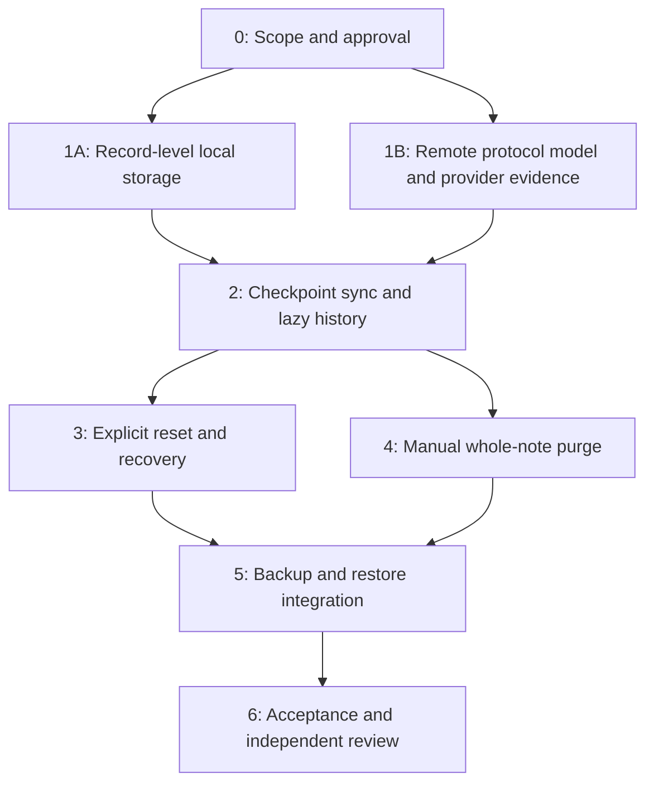

# PLAN-011: Dataset checkpoints and deletable note history

## Metadata

| Field | Value |
|---|---|
| Status | In progress: current Workspace and record adapter; application and remote integration pending |
| Owner | Project maintainer |
| Assigned To | Unassigned |
| Reviewer | Further review to be arranged by the maintainer |
| Date | 2026-11-01 |

## Related Spec

[SPEC-010](../specs/010-dataset-checkpoints-and-deletable-history.md), based on accepted-direction
[ADR-062](../decisions/062-dataset-checkpoints-and-deletable-history.md).
The [research](../research/2026-11-01-drive-dataset-checkpoints-and-deletion.md) distinguishes code observations,
reviewer-supplied JS timings, official API limits and untested assumptions.

## Overview and minimum delivery

The maintainer authorized implementation after the review revisions were committed. This does not authorize
operating on real account data. The minimum delivery is record-level local persistence, current-checkpoint bootstrap, old-format reset,
Delete forever and Empty Trash. Lazy history, attachment ownership and purge-aware bounded backup/restore are
necessary supporting work, not permission to narrow the existing recovery guarantees silently.

Automatic expiry, selective version deletion, history packs and writer vectors are excluded. Clear this note's
history is the first capacity follow-up; automatic days-based Trash expiry needs a later ADR. Archived notes
keep their existing behavior. No version bump is included: the persistence boundary belongs to the next
maintainer-approved minor application release, with its exact version separately authorized.

After Phase 0, **local persistence and remote protocol proof proceed independently**. Local performance work does
not wait for real Google authorization or completion of the publication model. The parallel tracks describe work
dependencies, not authorization to spawn agents or touch a live account.

## Implementation phases

### Phase 0: Review and authorize the scope

- [ ] 0.1 Review the revised ADR and the SPEC's file layout, queries, publication/retirement algorithm and four
  scenarios. Record independent-review outcome in the resulting commit body, not PROGRESS or a session log.
- [x] 0.2 Resolve SPEC Q03-Q05: terminal purge versus unseen restore, MVP manual commands, first-run/recovery
  choices, background bulk completion and initial backup coverage/capacity. No Trash-days decision is needed now.
- [ ] 0.3 Approve local-storage work separately from remote model/probe work. Identify named benchmark environments
  and, if wanted, separately authorize isolated Google test resources; this document does not authorize cloud writes.
- [x] 0.4 Mark only accepted decisions as accepted and authorize their implementation scope. Keep exact application
  release target and release dispatch separate. Do not weaken U03/U04 silently to fit an experiment.

**Deliverable**: agreed MVP and approval boundaries. The existing external review is input; the revised protocol
still needs its own review. Author checks are not independent review.

### Phase 1A: Local record storage and immediate performance benefit

Depends only on relevant Phase 0 approval, not Phase 1B or a Google grant.

- [ ] 1A.1 Define typed bounded transactions/paged reads for current entities/heads, revisions, unsaved baselines,
  outbox, attachments and maintenance journals. Preserve one writer, account/session fencing, local CAS and durable ack.
- [x] 1A.1a Add the shared record transaction, receipt, paging and attachment contract, with account-scoped
  IndexedDB and native SQLite primitives. Verify rollback and exact acknowledgement replay. Inner entity/head,
  unsaved-baseline and maintenance payload schemas remain part of 1A.1/1A.2; the application still uses its old store.
- [ ] 1A.2 Refactor Workspace/projection so typing, save and search do not copy/rebuild all historical revisions.
  Embed the unsaved baseline needed for ADR-061 comparisons without old-history reads.
- [x] 1A.2a Implement the explicit current-format Workspace, bounded current-head graph, self-contained draft
  baselines and WorkspaceRecordStorage adapter. Load only current/meta/draft indexes, persist changed rows,
  page pending uploads/history and atomically select staged bulk generations. The production entry point and
  backup/history UI still need conversion before 1A.2 is complete; no old format is automatically converted.
- [ ] 1A.3 Implement IndexedDB and native SQLite/bridge semantics on Windows, macOS, Linux, iOS and Android.
  A history table behind a whole-workspace JSON save API does not satisfy this task.
- [ ] 1A.4 Implement incompatible-local-profile detection and the explicit preservation/discard/rejoin screen.
  Do not convert or silently delete old local data to exercise the new store.
- [ ] 1A.5 Reproduce or replace the supplied JS-only baseline with a recorded harness, hardware/runtime, fixture
  sizes and methodology; then measure native storage/bridge separately. Cover rollback, uncertain ack, restart,
  account switch, clones and large histories (VC02, VC09, VC12, VC20, VC25).

**Deliverable**: independently usable record-level storage and measured local benefit. Changes can be reviewed
and landed without waiting for the cloud proof, while the incompatible-release policy remains enforced.

### Phase 1B: Prove the specified remote candidate and capacity

Starts alongside Phase 1A. Model work does not require real Google credentials.

- [ ] 1B.1 Translate SPEC-010's concrete kinds/properties/queries and algorithms into strict V1 codecs and a
  deterministic state-machine model. Keep UUID parents; no writer incarnation or history-pack subsystem.
- [ ] 1B.2 Exercise all four SPEC scenarios and every create/read/list/delete interruption: partial uploads,
  coalesced changes, stale pages, lost replies, concurrent checkpoints, late duplicate receipts and covered-input
  removal. Establish safe orphan handling; age alone cannot authorize deleting a possible live dependency
  (VC03-VC09, VC16, VC19, VC21, VC22).
- [ ] 1B.3 Demonstrate that unknown ancestry preserves branches and classify conservative false conflicts.
  Validate the proposed behavior rather than quietly restoring an unbounded ancestor walk (Q02, VC08, VC09).
- [ ] 1B.4 Measure admitted tail/candidate size and derive finite in-flight overshoot for the supported concurrency
  profile. Test continuous writers, failed retirement, partial publications, many purge markers and group history.
  Show usable local state and progress under overload, not an endless bootstrap restart (VC07, VC19, VC26).
- [ ] 1B.5 Use a lazy provider with H = 10k / 100k / 1m at fixed current state. Instrument forbidden history work.
  Separately test a hot note, folder/account capacity errors, property limits and bounded marker queries; a million
  synthetic files is not evidence of real app-data support (VC01, VC26; Q07).
- [ ] 1B.6 With separately authorized isolated Google data, verify nested app-data folders, filtered discovery,
  paginated/changed results, publication visibility, checksum read-back, folder cascade and late uploads. Verify
  quota behavior through documentation/safe probes or error injection; do not create millions of real files merely
  to hit a limit. Record unknown appData-specific enforcement explicitly.
- [ ] 1B.7 Independently assess safety/progress results and resolve Q01/Q02/Q07 before accepting dependent remote
  code. Revise the candidate if it fails; do not substitute CAS, timestamps, a whole-history scan or silent LWW.

**Deliverable**: reviewed protocol with measured limits and separate model/provider evidence. A concrete design
is necessary for proof, but is not itself a proof or a passing real-provider test.

### Phase 2: Checkpoint sync and lazy per-note history

Depends on the local transaction contract and reviewed remote candidate.

- [ ] 2.1 Implement the dataset/ready descriptor, folder reservations, immutable revision/change/checkpoint kinds
  and typed provider queries. Keep OAuth tokens, upload URLs and arbitrary HTTP/SQL unavailable to the renderer.
- [ ] 2.2 Implement token-before-list bootstrap, bounded catch-up, current reconciliation, relevant purge checks
  and atomic activation. Preserve local outbox/unsaved work and generation isolation (VC01, VC03, VC06, VC07).
- [ ] 2.3 Implement one history-body upload plus small current receipt; checkpoint exact inputs before retiring
  receipts/predecessor snapshots. Retain revisions as history and enforce admission/backpressure (VC04, VC05, VC19).
- [ ] 2.4 Implement paged note-folder history and direct selected-version reads; restore via a new UUID and fresh
  head preview. Load attachments on demand, with truthful cache availability (VC08-VC10).
- [ ] 2.5 Verify every adapter, conflict behavior, group redirects and cloned/restored outbox replay. No shared
  checkpoint chunks, packs or separate complete history copy are introduced.

**Deliverable**: normal current operations independent of H. Destructive UI remains disabled until its own gates pass.

### Phase 3: Legacy reset, first-run choices and cloud-loss recovery

- [ ] 3.1 Detect unsupported local/cloud layout with bounded metadata/header reads; local and cloud discard choices
  remain separate. Keep old profiles/backups intact unless their exact deletion is confirmed (VC20).
- [ ] 3.2 Persist the old file-ID capture, legacy-compatible reset fence, new isolated dataset plan, readiness and
  exact-ID cleanup stages. Never reuse the old unfiltered delete-all loop after new files exist (VC21, VC22).
- [ ] 3.3 Add localized all-device update/stop warning and test fixtures for 0.4.x normal sync, an in-flight old
  reset and a newly invoked old Reset all / overwrite-Google operation. The fence is mitigation, not revocation.
- [ ] 3.4 Detect missing root/fence/ready state; preserve usable local data, inspect new generations and offer
  explicit rejoin/recovery/export. Preview missing history/attachments and require confirmation before a new
  generation is republished from local data. No automatic resurrection (VC21, VC24, VC25).
- [ ] 3.5 Exercise interrupted/competing initializers, intentionally empty workspaces and follower activation.
  Keep new-state readiness distinct from old-data cleanup completion (VC22, VC26).

**Deliverable**: recoverable no-migration reset and first-run UX, including the old client's destructive behavior.

### Phase 4: Manual permanent note deletion and Empty Trash

- [ ] 4.1 Implement the approved terminal identity barrier, exact note/episode preview and idempotent purge journal.
  Implement only Delete forever and Empty Trash; retain `trashedAt` / `trashEpisode` without expiry machinery
  (VC11-VC15, VC18).
- [ ] 4.2 Sanitize current/redundant checkpoint copies before deleting them; remove the exact note-owned folder,
  history and attachments with verified cascade or metadata-only fallback. Reconcile late publications and leave
  ambiguous cleanup pending, preserving every neighboring head (VC05, VC16, VC17).
- [ ] 4.3 Revalidate uploads/restore/export; preserve distinct unpublished work for explicit Save as copy with new
  identity and remote attachment ownership. Invalidate cached history/previews/undo on reconnect (VC12, VC17, VC18).
- [ ] 4.4 Implement targeted purge queries and durable device cleanup acknowledgements, not startup loading of
  every historical tombstone. Do not garbage-collect the last barrier in a live dataset (VC19).
- [ ] 4.5 Verify pending/committed/cloud-cleanup wording, worker interruption, foreground priority, account changes
  and resumes. No claim about erasing offline devices or previously exported files (VC14, VC25, VC26).

**Deliverable**: explicit whole-note permanent deletion. Automatic expiry and per-version deletion remain deferred.

### Phase 5: Bounded backup and purge-aware restore

- [ ] 5.1 Implement explicit Complete retained history / Current state only coverage in the V1 manifest, capture
  revalidation and hydration of declared bytes. Preserve self-contained recovery, unsaved work/layout, encryption,
  existing grants and durable save receipts (VC12, VC23).
- [ ] 5.2 Preflight and enforce existing ZIP entry/byte limits; fail intact without a valid-looking partial export.
  Keep automatic backup's last good artifact and report failure instead of silently reducing scope. If Q04 rejects
  the initial capacity boundary, design/review the larger streaming/container path before calling this phase done.
- [ ] 5.3 Enforce purge barriers during merge/replace/history restore. Preview explicit recovery as new identities;
  full Google replacement is a new-generation reset, not a bypass of deletion knowledge (VC24).
- [ ] 5.4 Test purge/reset during capture, uncached history/attachments, oversized notes/archives, encryption,
  cancellation, stale previews and process death on all hosts (VC12, VC23-VC26).

**Deliverable**: truthful bounded backup/restore. Million-version complete exports are not claimed under the initial
container; a cache subset cannot pass as complete retained history.

### Phase 6: Acceptance, documentation and independent implementation review

- [ ] 6.1 Run documented JS/Python and applicable native/browser checks plus SPEC VC01-VC26. Report untested
  platforms/provider boundaries as untested, not as passing because a model passed.
- [ ] 6.2 Record fixed-current H scaling, absolute latency and provider/bridge work on named environments; include
  background maintenance contention, folder/marker capacity and supported concurrent writers.
- [ ] 6.3 Obtain independent read-only protocol, destructive-operation and implementation review; fix findings with
  focused regression coverage before enabling destructive commands against real user data.
- [ ] 6.4 Update owning ADR/SPEC supersession, this plan's status/tasks, architecture/testing/native contracts and
  both user-guide editions as approved behavior lands. Change PROGRESS only for actual project-level state.
- [ ] 6.5 Confirm the incompatible minor-release boundary in deployment guidance; ask for a target version only
  when release work is requested. Do not bump, dispatch or add release bookkeeping as part of feature acceptance.

**Deliverable**: reviewed MVP with explicit verified/unverified boundaries and no automatic migration.

## Follow-up ordering

1. Propose and review manual Clear this note's history, preserving current/conflict heads; then selective Delete
   version. Define captured targets, deletion markers and backup/late-upload rules before enabling either command.
2. Design large complete-backup support if the initial capacity boundary is insufficient. Do not make manual data
   deletion a condition of obtaining a complete backup.
3. A separate ADR defines automatic whole-note Trash expiry: days, clocks, concurrent restoration and scheduling.
   Do not prebuild episode policies, cloud-time anchors or deadline queues for an unselected behavior.
4. Any change to archive editability needs a separate interaction decision. Current editable archive behavior
   remains compatible with permanent Trash cleanup and need not block this MVP.

## Expected integration points

| Area | Work |
|---|---|
| `contracts/sync.d.ts`, `contracts/native.d.ts`, `contracts/backup.d.ts` | V1 dataset/current/history records, typed storage and coverage |
| `src/core/workspace.js`, `src/sources/revisions.js`, `src/sources/projection.js` | Record transactions, current heads and conservative causality |
| `src/sources/file-sync.js`, `google-drive.js`, `files.js`, `source-reset.js`, `workspace-initialization.js` | Queries, publication/retirement, folders, fences, reset and recovery |
| `src/storage/native.js`, `src/storage/indexed-db.js` | Indexed reads/writes and incompatible-profile handling |
| Native databases, bridges and Google adapters for all five hosts | Durable bounded operations, strict transport and failure handling |
| `src/backup/`, `src/app/backup.js`, `src/app/automatic-backup.js`, conflict/history UI | Coverage, capacity, purge-aware recovery and lazy history |
| Locale catalogs and native string tables | First-run/reset warning, progress, conflicts and capacity/recovery choices |
| `tests/`, `tests/native/`, `scripts/testing/` | Model faults, measured budgets, platform and isolated provider verification |

## Testing strategy and risks

Run the record-store checks documented in [testing](../testing.md#dataset-checkpoint-and-deletion-verification),
the shared JS/Python suites, applicable native builds, documentation checker and language guard. Storage primitive
tests do not establish Workspace latency or any remote protocol/provider acceptance case.

| Risk | Required evidence or mitigation |
|---|---|
| Retiring a reference hides a branch | Concrete coverage model, race permutations and independent review |
| Current discovery grows with history/crashed publishers | Instrument candidate/tail counts, bounded admission and progress under supported concurrency |
| Unknown ancestry creates unwanted conflicts | Explicit examples and acceptance of conservative behavior; no silent data winner |
| Purge misses snapshot/late-upload copies | Sanitize/capture exact inputs, recheck barriers, truthful cleanup boundary |
| Old client deletes the new dataset | Legacy fence, update warning, destructive-old-client fixture and confirmed recovery |
| Large history exceeds folder or backup capacity | Explicit initial limits, metadata/byte failure tests and separately reviewed capacity expansion |
| Local speed improvement waits for Google | Independent Phase 1A with its own approval and benchmark |
| One adapter keeps whole-workspace writes | Shared transaction fixtures plus actual native/IndexedDB instrumentation |

Only checked tasks are complete. Remote model/provider evidence, independent review and product integration remain
required; implementation authorization is not a passing acceptance result.
