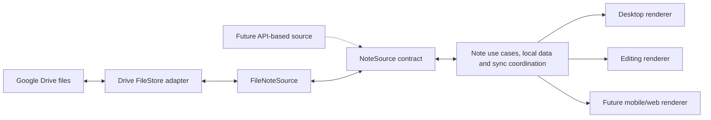

# 1.0.0 Google Drive notes MVP: feasibility and extension boundaries

> 2026-10-04 update: the Google/Drive capability research stands; for the latest product interaction and the open content scope, see
> [SPEC-003](../specs/003-desktop-cards-groups-and-formation.md).
> The old narrow-scope proposal does not authorize leaving out groups/formation, cutting checklists/attachments or restricting backups.

- Date / official documents consulted: 2026-10-03.
- Status: the user has asked to narrow down to a Google account + file-based notes, with no local server in the first version.
  The concrete choices in this document for Drive, the data space and the sync protocol are still Proposed.
- The [full product architecture draft](2026-10-03-product-architecture-blueprint.md) and ADR-003 are kept
  as later research; Project/Item/self-hosted server are not treated as required for 1.0.
- Which platforms ship together in 1.0 is not yet decided; the existing Windows/macOS/Linux and Apple/Google goals remain.

## 1. Feasibility conclusion

Recommendation: store this app's note files with the Google Drive API. A regular user signs in with Google OAuth
and consents to the needed permissions, and the app manages the data location; the user does not create a Cloud project, API key,
service account or local server.

The developer still has to configure Google Cloud/OAuth, production signing and public product/privacy pages.
"No server" here means no in-house note data service or token broker;
a static product website stores no user notes and does not amount to adding a sync backend.

Google Keep's official interface does not fit this version's scenario of two-way editing with a regular account.
This app's data in Drive also does not turn into Keep notes automatically.

## 2. Key differences between Keep and Drive

| Source | Official capabilities and limits | Judgement for 1.0 |
|---|---|---|
| Keep API | Aimed at enterprise administration; authorization is described as domain-wide delegation | Cannot promise that a regular personal Google account works on sign-in |
| Keep notes resource | Listed operations are create/get/list/delete; no update/patch content interface | Does not fit in-place two-way editing |
| Drive API | Can manage the app's files, with narrower authorization scopes | Suitable as the first provider |
| Unofficial Keep interfaces / web scraping | Outside the officially supported contract | Not a basis for this version |

This is a selection conclusion based on the current public APIs; it is not generalized to "Keep will never have any way to integrate".
Sources: [Keep overview](https://developers.google.com/workspace/keep/api/guides),
[Keep notes methods](https://developers.google.com/workspace/keep/api/reference/rest/v1/notes).

## 3. Drive storage location

| Mode | User experience | Trade-off |
|---|---|---|
| appDataFolder + drive.appdata | After authorizing at sign-in, the app-specific space is used automatically | Not visible as a regular Drive folder, cannot be shared with other apps/accounts, and cannot use the Drive trash |
| Regular folder + drive.file | Uses a data location the app created or the user picked | Files are visible; must handle the user moving/deleting them, external format edits and initialization races |

Both scopes are listed as non-sensitive; this is no reason to skip the formal OAuth branding/configuration work.
[Drive scopes](https://developers.google.com/workspace/drive/api/guides/api-specific-auth)

**This project's initial recommendation is appDataFolder**, which suits "the same person's N machines, ready to use after sign-in".
Provide export, and explain that removing the app or clearing app data may delete the remote content.
If the first version must let users see/organize the files directly in Drive, choose drive.file instead;
the choice must be made before implementation, without quietly creating two authoritative copies of the data.
[appDataFolder constraints](https://developers.google.com/workspace/drive/api/guides/appdata)

AppDataFolder content must be edited by this app; Google Drive/Keep will not provide our notes UI.
If "the phone must edit directly in the existing Keep/Docs app" is a requirement, this approach does not meet it,
and another source that can operate on that document format is needed. A visible JSON file is not a note-editing experience on the phone either.

OAuth client IDs for each platform should be managed consistently under one product/Cloud project.
That the same Google account sees the same data space across different client IDs must be an integration acceptance check;
two windows sharing one token do not prove cross-device behaviour.

## 4. The narrow 1.0 product

Recommended deliverables:

- Google sign-in/authorization, reconnect, sign-out and account switching; initially one data source is active at a time.
- Creating, editing, deleting/restoring one card per thing and the latest group interaction; the body/checklist/attachment scope is confirmed separately, with no default plain-text-only restriction.
- Multi-note desktop display, per-machine position/size/highlight settings, locked click-through and deliberate unlock for editing.
- Multi-device sync, local cache and reliable drafts, recognizable pending/conflict indicators.
- Data export / import from backup, and recoverable behaviour when Google authorization is revoked or on quota/network errors.
  See the [backup and restore specification](../specs/002-portable-backup-and-restore.md); this round's planning baseline uses appDataFolder.

A self-hosted server, QR pairing, team permissions, aggregating several sources at once, a PM kanban board or agent states are not part of 1.0.
Interfaces for future multiple providers and multiple renderers are kept; the first version implements only the one chosen provider and release platforms.
If phone editing is to be part of 1.0, a matching client of this app / an explicit editing entry point must ship; "the data is in Drive" is not enough.

## 5. Heterogeneous sources and renderers: what is kept now

Split into three responsibilities, rather than treating every external service as the same file system:

1. **NoteSource**: provides reading, committing, deleting, conflicts and source capabilities in note semantics.
   It exposes opaque revision/cursor/source references. An API-based source can implement it directly.
2. **FileStore adapter**: used only by file-based sources; handles Drive sign-in, listing, reading/writing, paging and errors.
   FileNoteSource owns this app's file format and conflict rules, so the renderer never parses Drive JSON.
3. **Renderer / platform host**: gets the same NoteViewModel and sends edit intents.
   Window level, click-through and size are managed by the platform host; the renderer never holds OAuth tokens or writes files directly.

Minimum data boundaries:

- NoteDocument: schemaVersion, noteId, title, body (exact format to be decided, no default plain-text restriction), optional appearance information.
- SourceRef: providerId, accountId, collection identity, opaque external identifier.
- Sync envelope: operationId, revision/parents, deletion marker and source-specific metadata; kept separate from visible content.
- Local state: drafts, outbox, remote cache, sync cursor, per-machine layout; partitioned by source/account.
- Credential store: native secure storage; never in notes, Drive files, diagnostics or the renderer.
- Unknown schemas/content kinds keep their raw data and restrict editing; fields must not be dropped by a downgrade save.
- Switching sources keeps the original data; moving across sources is handled in future by a verifiable export/import, never by hidden two-way sync.

Example capability contract: canEdit, canDelete, canRestore, supportsChecklist, conflictMode,
changeFeed. Capabilities a source does not support are listed in the UI, not masked by an empty success reply.
FileStore's conditionalWrite may only be declared when the adapter has proven support;
not every source can be required to implement our self-hosted server's SQL transaction or epoch protocol.

These interfaces start as modules within one app; no dynamic plug-in platform, separate service or cross-language ABI is built.

## 6. File-based storage still needs a sync consistency design

One notes.json holding all data widens the overwrite scope; one mutable file per note does not automatically remove races either.
Reading the version and then writing is two operations and cannot be treated as compare-and-swap.
Drive's version history or modifiedTime is not the app's conflict resolution protocol either.

In this review of the files.update and uploads documentation, no evidence was found that would let us promise atomic If-Match behaviour
for a particular v3 media upload; this stays unverified, with no claim that it is or is not supported.
[files.update](https://developers.google.com/workspace/drive/api/reference/rest/v3/files/update)

**Recommendation: design the conservative path of appending version files first**:

- Each confirmed save adds one immutable note version, with noteId, operationId, parent revision IDs and the full body;
  typing is saved locally first, and unsent drafts are merged as appropriate, so not every keystroke creates a Drive file.
- When one parent version gets two children, keep both and show a conflict; an explicit choice/merge then creates a new version that references both sides.
- Never pick a winner by device clock; "the remote save succeeded" and "there is no concurrent version yet" are different states.
- A deletion is also a version record and forms a visible conflict with a concurrent edit; restoring is an explicit operation.
- Do not use a single overwritable manifest as the only truth; the index can be rebuilt from the set of versions.
  Missing pages, parents not yet downloaded and revoked permissions must not be read as user deletions.
- The first version does not garbage-collect old versions automatically; data volume/quota, export and future safe compaction must be counted in the design cost.
- This is a sync proposal still to be decided, not an assumption that adding version files has already proven reliable; it should be compared with a
  conditional-update approach backed by evidence before the implementation contract is frozen.

Drive supports pre-generating file IDs, including for appDataFolder; the ID can be stored with the local pending operation.
A retry after the same create succeeded returns 409; the client must also read back and confirm the content matches its own operation,
and must not treat any 409 as success.
[generateIds](https://developers.google.com/workspace/drive/api/reference/rest/v3/files/generateIds),
[Retrying file creation](https://developers.google.com/workspace/drive/api/guides/manage-uploads)

The initial scan and the changes cursor must handle new changes during the scan, paging and duplicates, and save local data together with the cursor.
The Changes API supports appDataFolder.
[changes.list](https://developers.google.com/workspace/drive/api/reference/rest/v3/changes/list)

Without an in-house backend, the first version uses moderate polling, refresh on returning to the foreground and manual refresh, and does not promise always-on push within seconds.
Drive webhooks need an HTTPS receiver; this version adds no service for that.
[Drive push](https://developers.google.com/workspace/drive/api/guides/push)

## 7. How far Google sign-in and the Mac store really are

The existing 0.1.0 evidence supports the public AppKit API, Sandbox, real data updates and the focus policy.
It does not yet cover Google sign-in/Drive, and has only ad-hoc signing;
actual desktop gestures, full OS behaviour and store approval are still not done.
So the 1.0 scope can be narrowed, but "the Mac probe succeeded" does not support estimating that only the data source needs swapping before store release.
[Existing validation report](../validation/2026-10-03-validation-report.md)

Google's installed-app OAuth and the iOS/macOS SDK provide a direct sign-in path.
The authorization UI must not be placed in a WKWebView into which this app can inject script.
Using the Google Sign-In SDK on macOS adds Apple certificate signing and Keychain access group requirements;
validation artifacts that rely only on ad-hoc signing cannot count as this path being ready.
Desktop loopback and the Apple SDK URL scheme are options for different client types;
if sign-in has a brief callback listener, that is also different from a local server for note data, and its entitlement must be evaluated separately.
[Installed app OAuth](https://developers.google.com/identity/protocols/oauth2/native-app),
[Google Sign-In Apple platform setup](https://developers.google.com/identity/sign-in/ios/start-integrating)

The developer prepares the formal OAuth branding configuration, the required scopes, the product website and the privacy statement.
Regular users only complete sign-in/consent; they do not configure APIs for the developer.
[Google OAuth policy](https://developers.google.com/identity/protocols/oauth2/policies),
[Brand verification](https://developers.google.com/identity/protocols/oauth2/production-readiness/brand-verification)

Apple 4.8 has rules on third-party login, and also lists an exception for a client of a specific third-party service where the user signs in to access their content there.
Designing sign-in as connecting the user's own Drive, without creating a separate account for this product, has a reasonable architectural basis;
whether it qualifies for the exception must still be confirmed against the final product and review, and offering only Google cannot be guaranteed approval in advance.
The production bundle, privacy disclosures and reviewability still have to be completed.
[Apple Review Guidelines 4.8](https://developer.apple.com/app-store/review/guidelines/#login-services)

## 8. License assessment

Existing original code stays MIT. The Drive API terms of service / user data policy are separate from SDK code licenses.
The official GoogleSignIn-iOS repo uses Apache-2.0; it is a candidate component, not yet added to this repo,
with no version pinned and no inventory of all transitive dependencies yet. If adopted, keep the required notices and check the actual distributed artifacts.
No direct license obstacle has been found that would force abandoning the Drive route, but there is no claim that the whole of 1.0 has passed compliance review.
[SDK LICENSE](https://github.com/google/GoogleSignIn-iOS/blob/main/LICENSE),
[Google API Services User Data Policy](https://developers.google.com/terms/api-services-user-data-policy)

## 9. Designs kept and deferred

- ADR-001: the independent-development/backlog focus stays.
- ADR-002: keeps the actual 0.1.0 technology and evidence, without rewriting history.
- ADR-003 and the full product draft: Deferred, kept as research for future PM, self-hosted server and Item/View.
- The new 1.0 proposal adopts only the necessary parts: the source/renderer boundary, data portability and conflict protection.
- This session only reviewed public documentation and updated the design; no Cloud project was created, no Google sign-in was done,
  no Drive data was read or written, no SDK was added and nothing was submitted for store review.
