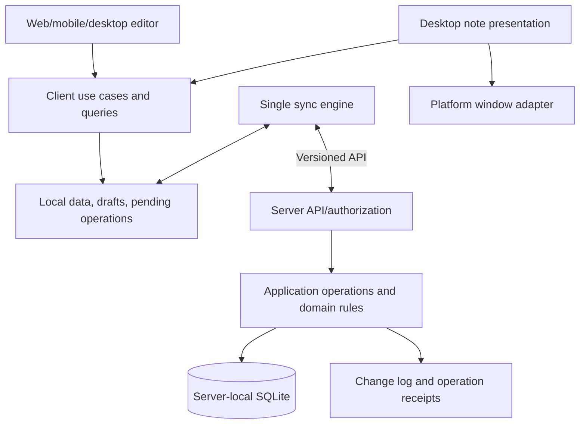

# Production architecture draft: backlog, sync and multi-client presentation

> 2026-10-04 validity update: this document is kept as historical research; it is not the current 1.0 interaction contract.
> The user has since moved to one card per thing, general-purpose groups, explicit formation and temporary z-order;
> the old Note container, per-item task model or other candidate UX must not override
> [SPEC-003](../specs/003-desktop-cards-groups-and-formation.md).
> The reasons for the change are in [the same-day summary](2026-10-04-desktop-card-interaction-design.md).

- Date: 2026-10-03.
- Status: Deferred; kept as the later design for full PM/self-hosted server, not required for the 1.0 MVP.
- The user's latest direction: a Google account + simple file-based notes, with no local server in the first version.
  The latest approach is in the [Drive MVP research](2026-10-03-google-drive-notes-mvp-feasibility.md); the original proposal below is kept for later reference.
- Baseline: 0a19aec, the 0.1.0 AppKit/Web/Python SQLite validation prototype.
- Current status is in [PROGRESS](../../PROGRESS.md); history and verification evidence are in the git history and [testing](../testing.md).

## 1. The product problem to solve

Every day the user needs to jot things down quickly, see unfinished items and occasionally update their state. The desktop is only an always-present entry point;
the phone and the web must also be able to operate on the same work data. Several development machines are one kind of work context;
there is no requirement to set up teams, agents, execution scheduling or a full project workflow first.

Proposed default experience: an Inbox is there on opening; type directly; turn something into a to-do when it needs tracking;
the only states are Todo/In Progress/Done. Project and environment assignment are optional information.
Unsynced/conflict are save indicators and must not be mixed into the three work states above.

## 2. Evidence from the current implementation and architecture gaps

| Current state | Value worth keeping | What the production design must add |
|---|---|---|
| One note record holds text, board and status together | The complete quick-capture flow | Separate the note container from to-dos that can be completed on their own |
| To-dos inside a Markdown string | People can type and export them directly | Stable to-do IDs, independent revisions and state |
| Each client polls a full snapshot | A common source has been validated | One client syncs once and shares with all windows; recoverable incremental reads |
| localStorage drafts and cache | Failure and conflict cases already exist | A transactional local store, persistent outbox, source isolation and export |
| Swift handles windows, network, QR and control UI in one file | Public API probe | The platform layer holds no sync rules or authoritative work state |
| WebKit downloads the editor from the server | Quick flow validation | The production app's UI and feature code ship in the bundle |
| Python stdlib HTTP/SQLite in one file | Reproducible API and data tests | Boundaries between transport, application operations, authorization and repository |

The 0.1.0 portable service tests on Windows/Python 3.13.7 give 12 passed, 1 error:
restore runs fsync on an rb handle and gets Bad file descriptor. This design does not fix the code,
and does not record this known problem as passed. The existing Mac evidence keeps its original limited scope.

## 3. Proposed domain model

| Concept | Responsibility | Minimum information |
|---|---|---|
| Workspace | Boundary of one body of data and its permissions | id, name; one created automatically at first |
| Note | A content container you write in directly | id, workspaceId, title, content order; may have defaults for new items |
| Item | Text or a to-do in a note | id, homeNoteId, kind, text, revision, deletedAt; only a task has status |
| Project | Organizes work by product/goal | Optional id, name; an Item may have no projectId |
| Environment | Where the work should be done | Optional id, name; an Item may relate to zero or more environments |
| View | Decides which data to look at | A fixed note, or limited-field filters and sorting; never copies Items |
| DeviceLayout | How this machine presents things | deviceId, viewId, position, size, display hints, highlight rules |
| Installation/Credential | Which installed instance has which access | Device id, role, credential and revocation state |

This is a responsibility model, not eight services or eight required settings pages. Project and advanced View can come in later slices;
the first editing flow needs only a default Workspace, an Inbox Note and Items.

Key rules:

- Each Item has one actual home note; views only reference the same ID. Moving keeps the ID and state.
- A text Item can be turned into a task while keeping its ID; plain text need not have a work state.
- A Note no longer shares one status with each of its to-dos. A note's completion ratio is derived; collapsing/archiving has its own meaning.
- Environment is a work context, Device is an access client. For example, the phone can view to-dos of the Mac environment.
  Reinstalling or revoking a device credential does not delete that environment's work.
- A Note's environment/Project defaults apply only when adding. Moving an Item or changing the defaults does not silently rewrite existing assignments.
- Quick add does not require any of the fields above. Without an explicit home, it writes to the Inbox.
- The three work states are currently fixed; no customizable workflow engine for now.

Example: one "Fix the login test" Item lives in the "Product A" note,
and also appears in "Unfinished on the Mac" and "All In Progress";
when the phone completes it, all three screens update, and only one state is changed.

## 4. Write semantics of notes and views

A regular note adds directly to itself; a filtered view carries an explicit captureTargetNoteId, defaulting to the Inbox.
Only an unambiguous single-environment/Project filter can serve as a default for adding;
fields are not guessed from complex conditions. If a new item does not match the view after adding, show where it was actually saved.

"Remove from desktop" changes only the DeviceLayout. "Move to another note" changes homeNoteId.
"Delete item" creates an Item tombstone. The three commands are kept separate, so a UI action cannot accidentally delete shared data.

The first version only needs the built-in note, unfinished list and three-column kanban board;
keep the View structure, without adding a custom query language or arbitrary scripts right away.

## 5. Module boundaries and deployment

Proposed: a single repo, a modular monolith server, a shared client core and platform adapters.
The server deploys as one program; each app has one local data/sync owner.



Dependency rules:

- The UI only calls use cases such as capture, edit, complete, move, delete and restore; it never writes the server DB directly.
- The client core handles local storage, sync, drafts and conflicts, and never imports AppKit/Win32/DOM.
- The view projection turns the same data into notes, lists and kanban boards, without storing a second task truth.
- Platform adapters handle windows, focus, mouse click-through, displays, tray/menu, QR and the secure storage entry point.
- The server maintains invariants through authorized application commands; client validation only improves UX.
- A shared schema generates the contract types for each language; the server validates input independently.
- N desktop notes share one sync engine and local store; each window has its own editing session,
  rather than each polling the server or writing its own notes JSON.
- If a multi-process shell needs IPC, the local store owner provides restricted commands; no public listener is opened just for multiple windows.

## 6. Source of truth and sync contract

**Proposal: the server is the sole authority for committed work data, and the local device is the authority for uncommitted drafts/operations.**
Start with a self-hosted single server + server-local SQLite. Markdown/JSON provide export/import;
providers can be added later, but two independently modifiable authoritative sources are not maintained for now.

SQLite sits on the same machine as the database engine, and clients access it through the API; multiple devices never sync or
share a live DB file directly. This agrees with [SQLite's official advice on network use](https://www.sqlite.org/useovernet.html).
This section is this project's selection proposal; it does not mean the existing prototype already has the full protocol below.

Minimum write contract:

- instanceId identifies the data service; workspaceId partitions data; epoch marks the generation after a recovery.
- operationId is generated at the first local save and does not change on retry. The receipt is bound to the actor, the generation and the full request content.
- expectedRevision targets the Item/Note metadata being modified. Different Items do not conflict just because they share a note.
- An outdated update to the same Item returns conflict/current and keeps the local candidate content; the first version does not auto-merge the same record's content.
- Ordering has its own orderRevision; a move across notes updates home and order in one server transaction.
- The write, change sequence number and idempotency receipt commit in the same transaction, and the success reply comes after the commit.
- A retry still re-checks authorization, revocation and epoch; an existing receipt never bypasses permissions.
- Tombstones stop old clients from bringing deleted data back to life; restoring uses a separate explicit command.
- The first version does not garbage-collect tombstones/receipts automatically; any later collection must first define an operation validity period and re-sync rules.

HTTP conditional updates can use If-Match; its semantics of preventing stale writes are in
[RFC 9110 §13.1.1](https://www.rfc-editor.org/rfc/rfc9110.html#name-if-match).
The concrete wire format, a header or a JSON expectedRevision, is left to the sync contract ADR.

Minimum read contract:

1. The initial snapshot and the change cursor are produced in the same consistent view.
2. Later, ordered changes are pulled by cursor; the client saves the data and the cursor in the same local transaction.
3. Push/SSE is a "something changed" hint; after a missed notification, the cursor can still fill the gap.
4. When the cursor expires or the epoch changes, re-fetch the snapshot; keep drafts and the outbox first, and never let the new snapshot wipe them.
5. The phone catches up when it returns to the foreground, without relying on the OS to guarantee a permanent background connection.

Proposal: the first production slice already has a persistent outbox, providing offline add/edit and a clear pending indicator.
Operations on the same Item are processed in order; on a conflict that Item stops while other Items continue.
Unconfirmed operations do not have their IDs regenerated, get merged or have their body rewritten at will; candidate content not yet sent is stored separately from requests already sent.

## 7. Local data, device layout and security

- Local cache, drafts and the outbox are partitioned by instanceId/workspaceId/epoch, not by URL alone as the data identity.
  Re-pairing does not automatically send another source's pending operations to the new source.
- The desktop/mobile local store needs transactions; the web can use an IndexedDB adapter.
  Browser storage may be cleared, so the UI must be able to export drafts, with no promise that nothing is ever lost.
- Draft saving and send state must distinguish "on this device" from "committed by the server".
- DeviceLayout is stored locally at first and restored using the valid work area/display hints.
  The server may keep a backup of each device's layout, but one machine moving a note must not push other screens' notes around with it.
- Changing the sync source, logging out and revocation all keep unsynced content exportable, and say clearly that access has ended.
- Native apps keep the device key in a platform secure storage adapter. Roles are enforced by the server;
  lock/unlock only prevents accidental touches and cannot raise a viewer's permissions.
- A QR code carries only the server identity/location and a short-lived single-use invitation. TLS trust and network reachability are handled separately;
  scanning the code does not automatically connect a phone outside the LAN to a private machine.
- Initially one default workspace and a simple viewer/editor/admin; no multi-tenant SaaS administration system first.

## 8. Platform and app bundle boundaries

The formally installed app carries its own editor and client feature code; the server mainly provides the data API.
This lets local work open while the server is paused, and keeps app release versions and server versions managed separately.

If a Web UI is used, the native WebView's local origin differs from the remote API:
a native transport adapter with explicitly allowed origins and a defined command scope handles credentials/network;
no bridge to arbitrary URLs is opened and CORS is not loosened wholesale for convenience.
A standalone web entry point is recommended to share an origin with the API, with its own browser security/session design.

Apple requires public APIs, restricts downloading code that changes functionality, and also requires apps to have enough functional value.
Bundled UI, offline data and platform integration are this project's architecture strategy, not a guarantee of store approval,
nor a judgement that all remote web content is forbidden.
[Apple Review Guidelines 2.5.1, 2.5.2, 4.2](https://developer.apple.com/app-store/review/guidelines/)

The desktop adapter reports capabilities such as clickThrough, desktopAboveIcons, desktopBelowIcons and
multiWindow; when a capability is unavailable, the limit is listed explicitly and the normal editing/sync entry points remain.
The core is not required to understand NSWindow levels, WorkerW or compositor protocols.

macOS uses only public APIs and the Sandbox; the iOS/Android store apps provide a real editing/offline/pairing experience.
The Windows MSIX and specified Linux environment release directions keep the original requirements. Real platform tests stay in the integration/release acceptance stage;
this session does not extend the probes, and does not relabel untested capabilities as passed.

## 9. Tech stack: compare first, never decide automatically from the prototype

| Route | Main architectural cost | How this project evaluates it |
|---|---|---|
| Shared TypeScript editor/client + per-platform shells | Needs a native bridge and storage adapters; some logic crosses languages | High shared-UI density; listed as the route to compare first |
| Shared Flutter UI/client + native adapters | Brings in Dart and platform bridges; special desktop windows still need platform work | Compared together with the mobile/desktop sharing needs |
| Native UI per platform + shared API/schema | Each client's editor and sync behaviour must stay consistent; more implementation work | Kept as the most direct route for platform integration |

The table is a maintenance cost analysis; it does not claim any framework has passed this project's platform/store acceptance.
The TypeScript route does not mean React, Tauri or a particular mobile shell is chosen now.
Tauri's official documentation still lists a macOS private API setting; if it is chosen, the window/feature conditions used must be listed one by one.
[Tauri configuration](https://v2.tauri.app/reference/config/)

Proposed server: a modular monolith. The existing Python can serve as a protocol reference; a suitable Python service framework and
a single Rust/Axum service are both candidates. Whether to change language should be decided by deployment/maintenance cost and the formal API needs,
not by installing fewer packages or language preference.

The formal tech selection ADR must list: pinned versions, direct/transitive licenses, platform package sources, build/update methods,
multi-window and mobile storage bridge costs, and concrete reasons for rejection. No license audit is claimed before dependencies are added.

## 10. From the validation prototype to the production implementation

Keep the prototype until the new end-to-end flow can replace it; set up module boundaries and contracts first, then move or rewrite.
What carries over is the validated behaviour and test cases, not every function/file.

Proposed logical directories; this is a design sketch, and no files are moved in this session:

```text
apps/             entry points and packaging for web, desktop and mobile
core/             domain, client use cases, view projection
contracts/        API/schema, capability and error definitions
sync/             local sync engine and source/generation management
adapters/         local store, transport, platform windows, secure storage
server/           transport, commands, authorization, repository
tests/            contracts, data faults, cross-client and platform integration
```

A v0.1 import must have a preview and a backup: keep the note ID/original text/board/old state;
first store losslessly with legacy metadata and original-text Items, then let the user choose to turn checklists into separate Items.
A regex alone cannot guess how a whole-note Done and unticked sub-items should map. Old operation receipts are not forced across schemas;
the migration creates a new data generation and an explicit re-pairing/draft export flow.

Concrete outputs of the architecture stage, in order:

1. Domain invariants, data schema and the write semantics of Item/Note/View.
2. Sync contract, client store/outbox boundary and error model.
3. Selection ADRs for framework/runtime/licenses and each store bundle.
4. The first production slice: quick capture → persistence → second client → completion synced.
5. Then integrate multiple note windows, per-machine highlighting and per-OS release acceptance.

This order was adjusted to the user's request in this session; current status is in PROGRESS.md, and history is in the git history.

## References

- [Backlog user requirements](2026-10-03-backlog-first-product-requirements.md)
- [Existing view model research](2026-10-03-lightweight-project-management-and-view-model.md)
- [Existing sync research](2026-10-03-source-of-truth-sync-and-conflict-analysis.md)
- [Architecture entry point: current implementation](../architecture.md)
- [ADR-003 proposal](../decisions/003-product-architecture-boundaries.md)
- External sources consulted: 2026-10-03; the sync protocol, modules and data model above are this project's proposals.
