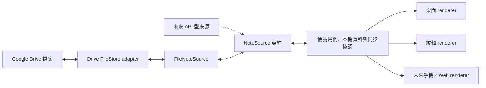

# 1.0.0 Google Drive 便箋 MVP：可行性與擴充邊界

- 日期／官方文件查閱日：2026-10-03。
- 狀態：使用者已要求收斂為 Google 帳號＋file based 便箋，第一版不架 local server。
  本文對 Drive、資料空間及同步協定的具體選擇仍是 Proposed。
- 保留 [完整產品架構草案](2026-10-03-product-architecture-blueprint.md) 與 ADR-003，
  列為後續研究，不把 Project／Item／自架 server 當成 1.0 必做。
- 尚未確定 1.0 同時發佈哪些平台；既有 Windows/macOS/Linux 與 Apple/Google 目標仍保留。

## 1. 可行性結論

建議採 Google Drive API 儲存本 App 的便箋檔案。一般使用者透過 Google OAuth
登入並同意必要權限，由 App 管理資料位置；不用自行建立 Cloud project、API key、
service account 或 local server。

開發者仍需配置 Google Cloud/OAuth、正式簽章與公開產品／隱私頁面。
此處「不架 server」是無自家便箋資料服務或 token broker；
靜態產品網站不保存使用者便箋，也不等於新增同步後端。

Google Keep 的官方介面不符合本版的普通帳號雙向編輯情境。
Drive 中的本 App 資料也不會自動變成 Keep 便箋。

## 2. Keep 與 Drive 的關鍵差異

| 來源 | 官方能力與限制 | 對 1.0 的判斷 |
|---|---|---|
| Keep API | 面向企業管理，授權以 domain-wide delegation 描述 | 不能承諾一般個人 Google 帳號登入即用 |
| Keep notes resource | 列出的操作是 create/get/list/delete；無 update/patch 內容介面 | 不符合就地雙向編輯 |
| Drive API | 可管理 App 的檔案，有較窄授權範圍 | 適合作為第一個 provider |
| Keep 非官方介面／網頁抓取 | 不在官方支援契約內 | 不作本版基礎 |

以上是依目前公開 API 的選型結論，不推廣成「Keep 永遠沒有任何整合方式」。
來源：[Keep 概述](https://developers.google.com/workspace/keep/api/guides)、
[Keep notes 方法](https://developers.google.com/workspace/keep/api/reference/rest/v1/notes)。

## 3. Drive 儲存位置

| 模式 | 使用者體驗 | 取捨 |
|---|---|---|
| appDataFolder + drive.appdata | 登入授權後自動使用 App 專屬空間 | 看不到普通 Drive 資料夾、不能分享給其他 App／帳號，也不能使用 Drive trash |
| 普通資料夾 + drive.file | 使用 App 建立或使用者選取的資料位置 | 檔案可見，需處理使用者移動／刪除、外部格式修改與初始化競爭 |

兩個 scope 都列為 non-sensitive；不因此略過正式 OAuth 品牌／設定工作。
[Drive scopes](https://developers.google.com/workspace/drive/api/guides/api-specific-auth)

**本案初步推薦 appDataFolder**，適合「同一人的 N 台機器，登入即可使用」。
提供匯出，並說明解除 App／清除應用資料可能刪除遠端內容。
如果第一版必須让使用者在 Drive 中直接看見／整理檔案，就改選 drive.file；
兩者要在實作前選定，不默默同時建立兩份權威資料。
[appDataFolder 限制](https://developers.google.com/workspace/drive/api/guides/appdata)

AppDataFolder 的內容需由本 App 編輯；Google Drive／Keep 不會提供我們的便箋 UI。
若「手機必須直接用既有 Keep／Docs App 編輯」是必要條件，這個方案並未滿足，
需另選可操作該文件格式的來源。可見的 JSON 檔也不等於手機已有便箋編輯體驗。

各平台 OAuth client ID 應有一致的產品／Cloud project 管理。
同一 Google 帳號在不同 client ID 間看見同一資料空間需作為整合驗收，
不能用同一 token 的兩個視窗當成跨裝置證明。

## 4. 1.0 的小範圍產品

建議交付：

- Google 登入／授權、重連、登出與帳號切換；初版一次啟用一個資料來源。
- 純文字便箋的新增、編輯、刪除／還原；簡單 checklist 可獨立評估，無 Project 或任務 workflow。
- 多便箋桌面展示、每機位置／尺寸／突出設定、鎖定穿透與主動解鎖編輯。
- 多裝置同步、本機快取與可靠草稿、可辨識的 pending／衝突提示。
- 資料匯出／從備份匯入，以及 Google 授權撤銷、配額／網路錯誤時的可恢復行為。
  詳見 [備份還原規格](../specs/002-portable-backup-and-restore.md)；本輪規劃基線採 appDataFolder。

不將自架 server、QR 配對、團隊權限、多來源同時聚合、PM 看板或 Agent 狀態納入 1.0。
未來多 provider 與多 renderer 保留接口；第一版只實作已選定的一個 provider 與發佈平台。
手機編輯若需要納入 1.0，必須交付相應的本 App 客戶端／明確編輯入口，不能只寫「資料在 Drive」。

## 5. 異質來源與 renderer：現在保留什麼

分成三個責任，而不是把所有外部服務當成相同檔案系統：

1. **NoteSource**：用便箋語意提供讀取、提交、刪除、衝突與來源能力。
   對外使用不透明 revision／cursor／source reference。API 型來源可以直接實作它。
2. **FileStore adapter**：只有檔案型來源使用；處理 Drive 的登入、列檔、讀寫、分頁與錯誤。
   FileNoteSource 負責本 App 檔案格式和衝突規則，不讓 renderer 解析 Drive JSON。
3. **Renderer／平台 host**：取得相同 NoteViewModel，送出 edit intent。
   視窗層級、點擊穿透與尺寸由平台 host 管理；renderer 不拿 OAuth token 或直接寫檔。

最小資料邊界：

- NoteDocument：schemaVersion、noteId、title、body（初版 plain text）、選用外觀資訊。
- SourceRef：providerId、accountId、collection identity、opaque external identifier。
- Sync envelope：operationId、revision／parents、刪除標記及來源特有 metadata；與可見內容分離。
- Local state：草稿、outbox、遠端快取、同步游標、每機版面；依來源／帳號分區。
- Credential store：原生安全儲存；不放便箋、Drive 檔案、diagnostics 或 renderer。
- 未知 schema／content kind 保留原始資料並限制編輯，不能降級儲存時丟欄位。
- 來源切換保留原稿；跨來源搬移未來以可核對的匯出／匯入處理，不暗中雙向同步。

能力契約例：canEdit、canDelete、canRestore、supportsChecklist、conflictMode、
changeFeed。來源不支援的能力在 UI 明列，不以空成功回覆掩蓋。
FileStore 的 conditionalWrite 只能在 adapter 證實支援時宣告；
不能要求所有來源都實作我們自架 server 的 SQL transaction 或 epoch 協定。

這些介面先是同一個 App 內的模組，不建立動態外掛平台、獨立服務或跨語言 ABI。

## 6. File based 仍須設計同步一致性

一個 notes.json 容納全部資料會放大覆蓋範圍；一張 note 一個 mutable 檔案也不會自動消除 race。
先讀 version 再寫是兩次操作，不能當成 compare-and-swap。
Drive 的版本歷史或 modifiedTime 也不是 App 的衝突解決協定。

本次查閱 files.update 與 uploads 文件，沒有取得足以承諾特定 v3 media upload
原子 If-Match 行為的證據；此項保持未驗證，不宣称一定支援或一定不支援。
[files.update](https://developers.google.com/workspace/drive/api/reference/rest/v3/files/update)

**建議優先設計追加版本檔的保守路徑**：

- 每次確認保存新增一個不可變便箋版本，含 noteId、operationId、parent revision IDs 與完整本文；
  輸入過程先保存在本機，適當合併尚未傳送的草稿，避免每個按鍵都產生 Drive 檔。
- 同一父版出現兩個子版時保留兩份，呈現衝突；明確選擇／合併後建立引用兩邊的新版本。
- 不依裝置時鐘選贏家；單純遠端保存成功與「尚無並行版本」是不同的狀態。
- 刪除也是版本記錄，與並行編輯形成可見衝突；還原是明確操作。
- 不用單一可覆寫 manifest 當唯一真相；索引可由版本集合重建。
  漏頁、尚未下載的 parents、撤銷權限不能直接解讀成使用者刪除。
- 初版不自動回收舊版本；資料量／quota、匯出與未來安全壓縮必須列入設計成本。
- 這是待定同步方案，不是假設增加版本檔就已證明可靠；應與有證據支持的
  條件式更新方案比較後，凍結實作契約。

Drive 支援預先產生 file ID，包含 appDataFolder；可把該 ID 隨本機待送操作保存。
同一建立成功後重試會回 409；client 還需讀回確認內容與自己的操作匹配，
不能看到任意 409 就當成功。
[generateIds](https://developers.google.com/workspace/drive/api/reference/rest/v3/files/generateIds)、
[重試建立檔案](https://developers.google.com/workspace/drive/api/guides/manage-uploads)

初始掃描與 changes cursor 要處理期間的新變更、分頁及重複項目，並把本機資料與游標一起保存。
Changes API 支援 appDataFolder。
[changes.list](https://developers.google.com/workspace/drive/api/reference/rest/v3/changes/list)

無自家 backend 的第一版採適度輪詢、回到前景重整與手動刷新，不承諾常駐秒級推播。
Drive webhook 需要 HTTPS 接收端；本版不為此追加服務。
[Drive push](https://developers.google.com/workspace/drive/api/guides/push)

## 7. Google 登入與 Mac 上架的實際距離

現有 0.1.0 證據支持公開 AppKit API、Sandbox、真實資料更新與焦點政策。
它尚未涵蓋 Google 登入／Drive，同時只有 ad-hoc 簽章；
實際桌面手勢、完整 OS 行為及商店核准仍未完成。
因此可以縮小 1.0 範圍，但不能從「Mac 探針成功」估算成只差換資料來源就能上架。
[現有驗證報告](../validation/2026-10-03-validation-report.md)

Google 的 installed-app OAuth 與 iOS/macOS SDK 提供直接登入路徑。
授權 UI 不能放進可由本 App 注入 script 的 WKWebView。
macOS 使用 Google Sign-In SDK 時另有 Apple 憑證簽章與 Keychain access group 要求；
目前只靠 ad-hoc 的驗證產物不能當作這條路徑已就緒。
Desktop loopback 與 Apple SDK URL scheme 是不同 client 類型的選項；
登入若有短暫 callback listener，也與便箋資料 local server 不同，需個別評估 entitlement。
[Installed app OAuth](https://developers.google.com/identity/protocols/oauth2/native-app)、
[Google Sign-In Apple 平台設定](https://developers.google.com/identity/sign-in/ios/start-integrating)

開發者準備正式 OAuth 品牌設定、必要 scope、產品官網與隱私說明。
一般使用者只完成登入／同意，不替開發者設定 API。
[Google OAuth policy](https://developers.google.com/identity/protocols/oauth2/policies)、
[品牌驗證](https://developers.google.com/identity/protocols/oauth2/production-readiness/brand-verification)

Apple 4.8 對第三方登入有規範，也列出「特定第三方服務 client、為存取其內容而登入」的例外。
把登入設計成連接使用者自己的 Drive、不另建本產品帳號有合理的架構依據；
是否符合例外仍須依最終產品與審查確認，不能預先保證只提供 Google 一定獲准。
正式 bundle、隱私揭露及審查可操作性仍須完成。
[Apple Review Guidelines 4.8](https://developer.apple.com/app-store/review/guidelines/#login-services)

## 8. 授權判斷

現有原創碼維持 MIT。使用 Drive API 的服務條款／使用者資料政策與 SDK 程式碼授權分開。
GoogleSignIn-iOS 官方 repo 使用 Apache-2.0；它是候選元件，尚未加入本 repo，
也尚未鎖版本或盤點所有轉遞依賴。採用時保留必要 notices 並檢查實際散布產物。
目前沒有發現必須放棄 Drive 路線的直接授權阻礙，但不宣稱整個 1.0 已完成合規審查。
[SDK LICENSE](https://github.com/google/GoogleSignIn-iOS/blob/main/LICENSE)、
[Google API Services User Data Policy](https://developers.google.com/terms/api-services-user-data-policy)

## 9. 保留與延後的設計

- ADR-001：獨立開發／backlog 重心保留。
- ADR-002：保留 0.1.0 實際技術與證據，不改写歷史。
- ADR-003 與完整產品草案：Deferred，保留未來 PM、自架 server、Item/View 的研究。
- 新 1.0 提案只採用來源／renderer 分界、資料可攜性與衝突保護等必要部分。
- 本次只查公開文件與更新設計；沒有建立 Cloud project、登入 Google、
  讀寫任何 Drive 資料、加入 SDK 或提交商店審查。
