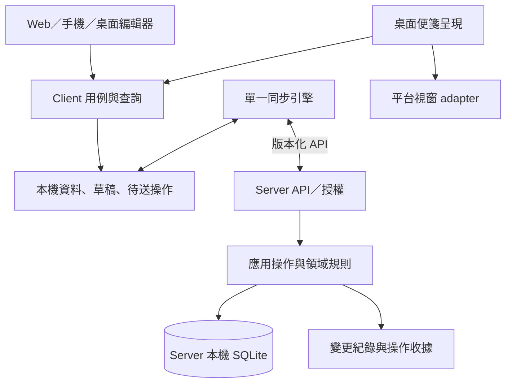

# 正式產品架構草案：backlog、同步與多端呈現

- 日期：2026-10-03。
- 狀態：Deferred；保留為完整 PM／自架 server 的後續設計，不列為 1.0 MVP 必做。
- 使用者最新方向：Google 帳號＋file based 簡單便箋，第一版不架 local server。
  最新方案見 [Drive MVP 研究](2026-10-03-google-drive-notes-mvp-feasibility.md)；下文保留原提案供後續參考。
- 基線：0a19aec，0.1.0 AppKit／Web／Python SQLite 驗證版。
- 執行狀態只記在 [PROGRESS](../../PROGRESS.md)。

## 1. 要解決的產品問題

使用者每天要快速記下事情、看到未完成事項，偶爾整理狀態。桌面只是常駐入口，
手機與 Web 也必須能操作同一份工作資料。多台開發機是一種工作脈絡；
不要求先建立團隊、Agent、執行排程或完整專案流程。

建議預設體驗：打開即有 Inbox；直接輸入；需要追蹤時轉為待辦；
狀態只有 Todo／In Progress／Done。Project 與環境歸屬都是可選資訊。
未同步／衝突是保存提示，不能混入上述三種工作狀態。

## 2. 目前實作提供的證據與架構缺口

| 現況 | 可保留的價值 | 正式設計需要補足 |
|---|---|---|
| 一筆 note 同時有 text、board、status | 快速記錄的完整流程 | 便箋容器與可獨立完成的待辦分開 |
| Markdown 字串內的待辦 | 人可以直接輸入與匯出 | 待辦穩定 ID、獨立 revision 與狀態 |
| 每個 client 輪詢完整 snapshot | 已驗證共同來源 | 一個 client 同步一次，供所有視窗共享；可恢復的增量讀取 |
| localStorage 草稿與快取 | 已有故障與衝突案例 | 有交易的本機 store、持久 outbox、來源隔離與匯出 |
| Swift 同檔處理視窗、網路、QR、控制 UI | 公開 API 探針 | 平台層不持有同步規則或權威工作狀態 |
| WebKit 從 server 下載 editor | 可快速驗證流程 | 正式 App 的 UI 與功能程式碼隨 bundle 發佈 |
| Python stdlib HTTP／SQLite 同檔 | 可重現 API 與資料測試 | transport、應用操作、授權及 repository 分界 |

0.1.0 的可攜服務測試在 Windows/Python 3.13.7 為 12 通過、1 錯誤：
restore 對 rb handle 執行 fsync，回 Bad file descriptor。本次設計不修正程式，
也不把這項已知問題寫成已通過。既有 Mac 證據保持原本限定範圍。

## 3. 建議領域模型

| 概念 | 責任 | 最小資訊 |
|---|---|---|
| Workspace | 同一份資料及權限邊界 | id、名稱；初始自動建立一個 |
| Note | 可直接書寫的內容容器 | id、workspaceId、標題、內容順序；可有新增預設值 |
| Item | 便箋中的文字或待辦 | id、homeNoteId、kind、text、revision、deletedAt；task 才有 status |
| Project | 按產品／目標整理工作 | 可選 id、名稱；Item 可不指定 projectId |
| Environment | 工作應在哪個環境進行 | 可選 id、名稱；Item 可關聯零至多個環境 |
| View | 決定看哪些資料 | 固定便箋或有限欄位篩選、排序；不複製 Item |
| DeviceLayout | 這台機器如何呈現 | deviceId、viewId、位置、尺寸、螢幕提示、突出規則 |
| Installation／Credential | 哪個安裝實例有何存取權 | 裝置 id、角色、憑證及撤銷狀態 |

這是責任模型，不代表八個服務或八個必填設定頁。Project 與進階 View 可以在後續切片實作；
第一個編輯流程只需要預設 Workspace、Inbox Note 及 Item。

重要規則：

- 每個 Item 有一個實際收納便箋；檢視只是引用相同 ID。移動時保留 ID 與狀態。
- text Item 可轉為 task，保留 ID；plain text 不必有工作狀態。
- Note 不再與每個待辦共用一個 status。便箋的完成比例是衍生資訊；收起／封存另有語意。
- Environment 是工作脈絡，Device 是存取 client。例如手機可查看 Mac 環境的待辦。
  重灌或撤銷裝置憑證不會刪除該環境的工作。
- Note 的環境／Project 預設值只在新增時套用。移動 Item 或修改預設值不靜默改寫原有歸屬。
- 快速新增不要求指定上述欄位。無明確歸屬時寫入 Inbox。
- 三種工作狀態是目前固定值；暫不做可自訂 workflow engine。

例：同一個「修復登入測試」Item 存在於「產品 A」便箋，
同時出現在「Mac 的未完成事項」與「全部 In Progress」；
手機完成它後三個畫面更新，只有一筆狀態被修改。

## 4. 便箋與檢視的寫入語意

普通便箋直接新增到自己；過濾檢視則帶明確的 captureTargetNoteId，預設 Inbox。
只有無歧義的單一環境／Project 篩選才能作為新增預設，
不從複雜條件推測所有欄位。新增後不符合檢視時提示實際保存位置。

「從桌面移除」只改 DeviceLayout。「移至別張便箋」改 homeNoteId。
「刪除事項」建立 Item tombstone。三個命令分開，避免 UI 動作誤刪共享資料。

第一版提供內建的便箋、未完成清單與三欄看板即可；
保留 View 結構，不立即加入自訂查詢語言或任意腳本。

## 5. 模組邊界與部署

建議採單 repo、模組化單體 server、共用 client 核心與平台 adapter。
Server 部署成一個程式；每個 App 有一個本機資料／同步 owner。



依賴規則：

- UI 只呼叫 capture、edit、complete、move、delete、restore 等用例，不直接寫 server DB。
- Client 核心處理本機保存、同步、草稿與衝突，不 import AppKit／Win32／DOM。
- View projection 將同一份資料轉為便箋、清單與看板，不保存第二份 task 真相。
- 平台 adapter 處理視窗、焦點、滑鼠穿透、螢幕、tray/menu、QR 與安全儲存入口。
- Server 以授權後的應用命令維持不變量；client validation 只改善 UX。
- 共用 schema 產生各語言的契約型別；server 對輸入獨立驗證。
- N 張桌面便箋共享同一個同步引擎與本機 store；視窗各有編輯 session，
  不各自輪詢 server 或各寫一份便箋 JSON。
- 多程序外殼若需要 IPC，由本機 store owner 提供受限命令；不因多視窗額外開公開 listener。

## 6. Source of truth 與同步契約

**建議 server 是已提交工作資料的唯一權威，本機是未提交草稿／操作的權威。**
採自架的單一 server + server 本機 SQLite 起步。Markdown／JSON 提供匯出／匯入；
將來可增加 provider，但目前不維護兩個可獨立修改的權威來源。

SQLite 與 database engine 同機，client 經 API 存取；不讓多台裝置直接同步或
共用運作中的 DB 檔。這與 [SQLite 官方的網路使用建議](https://www.sqlite.org/useovernet.html)
一致。此段是本案的選型建議，不代表現有原型已具備以下完整協定。

寫入最低契約：

- instanceId 識別資料服務；workspaceId 劃分資料；epoch 表示恢復後的世代。
- operationId 在首次本機保存時產生，重試不更換。收據綁定 actor、世代與完整請求內容。
- expectedRevision 針對被修改的 Item／Note metadata。不同 Item 不因共用一張便箋互相衝突。
- 同一 Item 的舊版更新回 conflict/current，保留本機候選內容；第一版不自動合併同筆內容。
- 排序有自己的 orderRevision；跨便箋移動在一筆 server transaction 內更新歸屬與順序。
- 寫入、變更序號及 idempotency receipt 同一交易提交，成功回覆在 commit 之後。
- 重試前仍重新檢查授權、撤銷與 epoch，不因存在收據而繞過權限。
- Tombstone 阻止舊 client 讓刪除資料復活；恢復使用獨立明確命令。
- 第一版不自動回收 tombstone／receipt；日後回收必須先定義操作有效期和重新同步規則。

HTTP 條件式更新可用 If-Match；其防止過時寫入的語意見
[RFC 9110 §13.1.1](https://www.rfc-editor.org/rfc/rfc9110.html#name-if-match)。
選擇 header 或 JSON expectedRevision 的具體 wire format 留給同步契約 ADR。

讀取最低契約：

1. 初始 snapshot 與 change cursor 在同一一致性視圖產生。
2. 後續按 cursor 拉取有序變更；client 將資料與 cursor 同一個本機交易保存。
3. 推播／SSE 是「有變更」提示，漏收後仍能依 cursor 補齊。
4. cursor 過期或 epoch 改變時重取 snapshot；先保留草稿與 outbox，不用新快照清空它們。
5. 手機回到前景時補齊資料，不依賴 OS 保證永久背景連線。

建議第一個正式切片就有可持久化的 outbox，提供離線新增／編輯與明確 pending 提示。
同 Item 操作按順序處理；遇到 conflict 停住該 Item，其他 Item 可繼續。
尚未確認的操作不隨意重建 ID、合併或重寫 body；尚未送出的候選內容與已送出的請求分開保存。

## 7. 本機資料、裝置版面與安全

- 本機快取、草稿與 outbox 以 instanceId/workspaceId/epoch 分區，不只以網址作為資料身分。
  重新配對不自動把另一個來源的 pending 操作送到新來源。
- Desktop/mobile 本機 store 需要交易能力；Web 可用 IndexedDB adapter。
  瀏覽器儲存可能被清理，UI 要能匯出草稿，不承諾絕對不遺失。
- 草稿保存與送出狀態要區分「在此裝置」及「server 已提交」。
- DeviceLayout 初始保存在本機，以有效工作區／螢幕提示還原。
  Server 可另存各 device 的版面備份，不能讓一台機器移動便箋後推著其他螢幕一起移動。
- 同步來源變更、logout、撤銷均保留可匯出的未同步內容；明確告知存取失效。
- 原生 App 的裝置密鑰使用平台安全儲存 adapter。角色由 server 強制，
  lock/unlock 僅為防誤觸，不能提升 viewer 的權限。
- QR 只攜帶 server 身分／位置及短效一次性邀請。TLS 信任與網路可達性另行處理；
  掃碼不會自動讓 LAN 外手機接上私人機器。
- 初期一個預設 workspace 與簡單 viewer/editor/admin；不先建多租戶 SaaS 管理系統。

## 8. 平台與 App bundle 邊界

正式安裝的 App 自帶 editor 與 client 功能程式碼，server 主要提供資料 API。
這讓 server 暫停時仍能打開本機工作，並把 App 發佈版本與 server 版本分開管理。

若用 Web UI，原生 WebView 的本機 origin 與遠端 API 不同：
由有明確允許來源及命令範圍的 native transport adapter 處理憑證／網路；
不為方便而開放任意網址的 bridge 或全面放寬 CORS。
獨立 Web 入口則建議與 API 同 origin，另有瀏覽器安全／session 設計。

Apple 要求公開 API，並限制下載會改變功能的程式碼；也要求 App 有足夠功能價值。
採隨包 UI、離線資料與平台整合是本案的架構策略，並非保證商店核准，
也不等於判定所有遠端 Web 内容都被禁止。
[Apple Review Guidelines 2.5.1、2.5.2、4.2](https://developer.apple.com/app-store/review/guidelines/)

桌面 adapter 回報能力，例如 clickThrough、desktopAboveIcons、desktopBelowIcons、
multiWindow；某能力不可用時明列限制，保留正常編輯／同步入口。
不要求核心理解 NSWindow level、WorkerW 或 compositor 協定。

macOS 只走公開 API 與 Sandbox；iOS／Android 的 store app 具備實際編輯／離線／配對體驗。
Windows MSIX 與 Linux 指定環境的發佈方向維持原需求。平台實測留在整合／發佈驗收階段，
本次不擴充探針，也不將尚未測能力改標通過。

## 9. 技術棧：先比較，不從原型自動定案

| 路線 | 架構上的主要代價 | 本案評估方式 |
|---|---|---|
| TypeScript 共用 editor/client + 各平台外殼 | 需定義 native bridge 與儲存 adapter；某些邏輯跨語言 | 共用 UI 密度高，列為優先比較路線 |
| Flutter 共用 UI/client + native adapter | 引入 Dart 與平台 bridge，桌面特殊視窗仍需平台工作 | 與手機／桌面共用需求一併比較 |
| 各平台原生 UI + 共用 API/schema | 各端 editor 與同步行為需維持一致，實作量較大 | 保留為平台整合最直接的路線 |

上表是維護成本分析，沒有宣稱任一 framework 已通過本案平台／商店驗收。
TypeScript 路線不等於現在就選 React、Tauri 或特定 mobile shell。
Tauri 官方仍明列 macOS private API 設定；若選它，須把所用視窗／feature 條件逐一列明。
[Tauri configuration](https://v2.tauri.app/reference/config/)

Server 建議模組化單體。現有 Python 可作協定參照；Python 適當服務框架與
Rust/Axum 單一服務都是候選。是否換語言應由部署／維護成本與正式 API 需求決定，
不把少裝套件或語言偏好當成產品架構理由。

正式技術選型 ADR 必須列：固定版本、直接／轉遞授權、平台套件來源、建置／更新方式、
多視窗與手機儲存橋接成本、具體捨棄理由。未加入依賴前不宣稱已完成授權稽核。

## 10. 從驗證版到正式實作

保留原型直到新的端到端流程可取代它；先建立模組邊界與契約，再搬移或重寫。
沿用的是已驗證的行為與測試案例，不要求沿用每個函式／檔案。

建議邏輯目錄如下；這是設計示意，本次不搬檔：

```text
apps/             web、desktop、mobile 的入口與封裝
core/             domain、client 用例、view projection
contracts/        API/schema、能力與錯誤定義
sync/             本機同步引擎與來源／世代管理
adapters/         本機 store、transport、平台視窗、安全儲存
server/           transport、commands、authorization、repository
tests/            契約、資料故障、跨 client 與平台整合
```

v0.1 匯入必須有 preview 與備份：保留 note ID／原文／board／舊狀態；
先以 legacy metadata 和原文字 Item 無損保存，再讓使用者選擇把 checklist 轉為獨立 Item。
不能僅用 regex 猜測整張 Done 與未勾選子項目應如何對應。舊操作收據不跨 schema 硬套；
遷移建立新的資料世代與明確的重新配對／草稿匯出流程。

架構階段的具體產出順序：

1. 領域不變量、資料 schema 與 Item／Note／View 的寫入語意。
2. 同步契約、client store/outbox 邊界與錯誤模型。
3. Framework／runtime／授權及各商店 bundle 的選型 ADR。
4. 第一個正式切片：快速記錄 → 持久化 → 第二 client → 完成同步。
5. 再整合多便箋視窗、每機突出及各 OS 發佈驗收。

這個順序依使用者本次要求調整；具體完成狀態以 PROGRESS 為準。

## References

- [Backlog 使用者需求](2026-10-03-backlog-first-product-requirements.md)
- [既有檢視模型研究](2026-10-03-lightweight-project-management-and-view-model.md)
- [既有同步研究](2026-10-03-source-of-truth-sync-and-conflict-analysis.md)
- [架構入口：目前實作](../architecture.md)
- [ADR-003 提案](../decisions/003-product-architecture-boundaries.md)
- 外部來源查閱日：2026-10-03；上述同步協定、模組與資料模型是本案提案。
