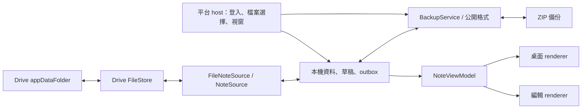

# SPEC-002: 1.0.0 可攜備份與安全還原

> 2026-10-04：本文件為保留的候選設計；使用者未批准純文字、無附件／版面備份、
> 無自動備份或唯一新增式還原等排除。先對齊
> [SPEC-003 的 Q01／Q02](003-desktop-cards-groups-and-formation.md)，再凍結格式。

## Metadata

| Field | Value |
|---|---|
| Status | Draft／待範圍確認及群組格式修訂，尚未實作 |
| Owner | 專案維護者 |
| Reviewer | 待獨立審閱 |
| 日期 | 2026-10-03 |

## Summary

1.0.0 以 Google Drive appDataFolder 作為目前的規劃基線，讓使用者登入後同步普通便箋。
本規格定義 App 內的「匯出備份」與「從備份匯入」，並把備份格式放在共用資料核心，
使備份可在重新安裝、更換 Google 帳號及未來更換來源時使用。
這是產品規劃，沒有把 ADR-004 或具體同步協定自動標為 Accepted。

## Goals

- 使用者可持有自己能保存、搬移及檢查的標準檔案。
- 備份保留便箋內容、可恢復刪除內容、並行版本及本機未同步文字。
- 匯入前可預覽；匯入不覆蓋已有便箋，中斷後可恢復同一次匯入。
- 檔案格式、資料來源及 renderer 可分別演進。

## Non-Goals

先前提案排除了覆蓋／時間點回滾、完整歷史、自動備份、附件與加密，
但使用者未批准這些範圍裁切，不能當作 1.0 的 Non-Goals。
下文具體流程保留為「新增式匯入」候選，是否只提供此模式仍需確認。
完整 PM 工作流不是目前重心；內容格式與備份能力依 SPEC-003 Q01／Q02 決定。

## User Stories

- 我想將目前的便箋存成一個檔案，日後 App 重裝也能取回。
- 我想在另一個 Google 帳號匯入舊資料，不重新連接原帳號。
- 我想先看備份包含什麼，再決定是否匯入。
- 我離線寫了一些文字，匯出時也希望保存；還原時先放草稿，不直接公開同步。

## Requirements

### Functional Requirements

| ID | 需求 |
|---|---|
| B01 | 設定中的「資料與備份」提供匯出、匯入及最近匯入結果；桌面展示不增加常駐工具列 |
| B02 | 匯出為一個標準 ZIP，由 OS 儲存／分享介面交給使用者 |
| B03 | 匯出前顯示本機快照時間、最後成功同步時間、待同步／草稿／衝突數量 |
| B04 | 一份備份只含目前選定來源／帳號的本機資料；其他帳號的快取不得混入 |
| B05 | 匯入先完整驗證並預覽數量、內容範圍及目標帳號，確認後才新增資料 |
| B06 | 本文候選流程「匯入為新便箋」不覆蓋既有資料；是否唯一還原模式尚未定案 |
| B07 | 同一次匯入使用持久化識別碼與 ID 對照表，重啟／重試不重複新增 |
| B08 | 匯入後經正常 outbox 同步；離線時明示已存本機、尚未同步 |
| B09 | 損壞、不支援或超出限制的檔案不得造成半套匯入或修改現有資料 |
| B10 | 匯入／匯出不得讀寫憑證、執行備份內的程式或取得額外 Drive 全域權限 |

### Non-Functional Requirements

- 資料正確性優先：無聲省略草稿、衝突或不認識的便箋資料都不能算完整備份成功。
- 本機匯入需具備交易或等效的原子提交；網路同步不宣稱多檔案原子交易。
- 大小與數量先在預覽解析階段限制；執行過程可取消並有進度回報。
- 第一版候選上限：ZIP 50 MiB、解壓總量 200 MiB、10,000 筆便箋、
  20,000 個 head／draft、單筆文字 1 MiB、JSON 最大深度 32。
  實作時依最低目標裝置壓測調整並寫入公開格式文件，匯出與匯入使用相同上限。
- 初版 ZIP 是明文，儲存介面旁簡短標示「備份包含便箋文字，未加密」；
  選取檔案的 OS 授權由平台 host 處理，臨時檔完成／取消後清理。
- 診斷記錄只含錯誤類別、數量及進度，不記便箋本文或憑證。

## Design Overview

### 1. 資料流與責任



| 模組 | 負責 | 不可依賴 |
|---|---|---|
| NoteSource | 便箋讀取、提交、刪除、衝突與來源能力 | renderer、ZIP 結構 |
| FileNoteSource | 本 App 的檔案同步格式、版本關係及衝突判定 | 原生視窗 |
| Drive FileStore | 列檔、讀寫、分頁、錯誤、Drive 識別碼 | 備份還原決策 |
| Local store / coordinator | 交易、快取、草稿、待送操作、帳號分區 | 特定視窗狀態 |
| BackupService | 匯出快照、驗證、預覽、匯入計畫及工作續傳 | OAuth token、Drive API |
| Platform host | 檔案授權／儲存、憑證、生命週期、視窗層級 | 將檔案 bytes 當可執行內容 |
| Renderer | 顯示 ViewModel、提出編輯／匯入意圖 | Google token、直接存取資料庫 |

同一 App 的多個便箋視窗使用單一協調者。所有帳號操作帶有固定 source session，
帳號切換後到達的舊非同步回應不得寫入新帳號。以上為邏輯模組，不要求建立服務或外掛。

### 2. 備份內容

| 資料 | 規劃 |
|---|---|
| 便箋 | 保存最終核准的完整本文、可選標題、共享外觀與群組引用；不得預先限定純文字 |
| 群組 | 需補上穩定群組資料及卡片引用的無損備份／匯入映射，舊格式尚未涵蓋 |
| 刪除區 | 保存刪除狀態與可恢復內容；匯入後仍留在刪除區 |
| 衝突 | 保存每個尚未解決的 head，包括刪除對編輯；不得替使用者選贏家 |
| 已保存待同步內容 | 以內容快照保存；不搬運舊操作封包 |
| 未保存草稿 | 預設包含全部本機草稿版本；還原到本機「恢復的草稿」，確認保存才上傳 |
| 每機版面 | 是否備份／還原待確認；若納入須按裝置分區。暫時 focus／capture 不是可恢復版面 |
| 歷史版本 | 本文快照候選不封存全部 ancestor；1.0 是否另含歷史封存待確認 |
| 憑證／同步內部資訊 | 排除 token、client secret、Drive file ID、游標、舊 outbox、鎖及 operation receipts |

便箋識別碼只是備份內部的引用，匯入時重新映射。備份不需要原帳號在線，
也不依賴原本的 Drive 檔案仍存在。來源名稱等資訊若保留，只作說明，不作授權或路由依據。

### 3. 公開檔案格式 v1 草案（未凍結）

以下歷史樣例尚未包含群組及引用，不可直接視為最新產品的完整可攜格式。
凍結前需補足 groups／membership 及已確認的內容能力，並測試完整往返。

預設檔名：`desktop-work-fleet-backup-YYYY-MM-DD-HHMMSS-<short-id>.zip`。

```text
manifest.json
notes.json
drafts.json
```

- 三個檔案使用 UTF-8 JSON；ZIP 支援 store／deflate。1.0 不接受加密 ZIP、符號連結或多卷封存。
- manifest：`format = "desktop-work-fleet-backup"`、整數 `formatVersion = 1`、
  隨機 `backupId`、`createdAt`、`appVersion`、`snapshotAt`、
  `lastSuccessfulSyncAt`（可空）、`syncState`、記錄數量及 payload 檔案的 byte length／SHA-256。
- syncState 僅用於來源新鮮度說明，例如 `caught-up`、`offline`、`pending`；
  `caught-up` 也只表示當時觀測的進度，不是全世界所有裝置都已上傳。
- notes：`notes[]` 各含 `backupNoteId` 和非空的 `heads[]`；
  head 含 `backupHeadId`、`deleted`、`document`。
  document 含 `schemaVersion`、`title`、`body`、選用 `appearance`。
  刪除 head 仍需有可恢復的 document。
- 同一 note 的多個 heads 表示需使用者處理的並行版本，不帶原 provider 的 revision。
- drafts：各含 `backupDraftId`、可空的 `backupNoteId`、`document`；
  沒有已保存便箋的草稿也能獨立恢復。不以時間戳消除其他草稿。
- 所有 ID 在各自範圍唯一；所有引用必須可解析；數量／hash 需匹配實際內容。
- SHA-256 用來偵測損壞，不能證明檔案來自可信作者。所有內容仍視為外部輸入。
- 實作前交付 JSON Schema、合法／非法範例及版本相容性規則；不從此摘要直接產生寬鬆 parser。
  未支援的 formatVersion／document schema 拒絕匯入，原檔保持不動。
  未知欄位依明確 schema 規則處理，不默默截掉再保存。

附件、加密或歷史封存是否納入首版仍需確認；格式一旦正式凍結，再以明確版本／能力演進。

### 4. 匯出流程與一致性

1. 將所有開啟 editor 的草稿寫入 local store 並取得確認；失敗就保留 UI 文字並中止匯出。
2. 線上時先嘗試同步已知遠端變更；若失敗，使用者可明確選擇匯出目前本機快照。
3. 透過一致的本機讀取交易取得便箋、heads、草稿與來源新鮮度資訊；
   不用分開的隨機檔案拷貝假裝成同一時間快照。
4. 缺失 parent、未知格式或未讀取完成的資料不能悄悄略過；
   阻止宣告完整備份，說明需要先修復／更新 App／完成同步。
5. 在暫存區產生 ZIP，重新驗證格式、數量與 hash，再交給 OS 儲存介面。
6. 只有平台確認儲存成功才顯示匯出成功；取消／磁碟滿不得留下被標為成功的半成品。

離線已知資料可以備份，但首次同步未完成的 client 只能匯出明確標示的本機資料快照。
尚未從其他裝置收到的內容不可能被包含；這項限制在預覽和 manifest 同步記錄。
App 不因匯出成功就清空草稿或 outbox，也不推論雲端已有另一份備份。

### 5. 匯入／還原流程

1. 選取檔案，在隔離暫存區驗證整個封存；驗證階段不寫目標資料。
2. 預覽活躍便箋、刪除便箋、衝突、草稿及備份時間；顯示即將匯入的帳號。
   內容只作純文字呈現，不能讓 HTML／script 執行。
3. 使用者確認「匯入為新便箋」。需有已選定、曾成功連接且可寫的來源；
   未登入者可先預覽，之後登入選定目標。短暫離線可先存到該帳號的本機分區。
4. 持久化 `restoreJobId`、備份檔指紋、目標 source ID、note/head/draft ID 對照及進度。
   草稿恢復採獨立本機記錄，不連回會自動保存的舊 editor。
5. 在單一本機交易新增資料、恢復工作與 outbox；任何本機失敗全部回滾。
6. 為每個匯入 note 建立新身份；並行 heads 保留為新 note 的並行版本，
   初始版本不指向已排除於備份之外的舊 ancestors。刪除項仍保存可恢復本文。
7. 經 NoteSource 正常送出；每筆操作維持同一操作識別碼與相同內容。
   不複製原 outbox，不替舊帳號撤銷權限，也不刪原 Drive 檔案。
8. UI 分別顯示「已匯入本機」與「已同步」，失敗可重試同一工作。

網路端可能已成功一部分；其他裝置可能逐筆看到新增便箋或暫時未完整的衝突集合。
1.0 不承諾整批瞬間出現。後續取得更多 head 時必須保留，而不是判定為舊資料丟棄。
崩潰或回應遺失後，以同一工作續傳，不依檔名／文字相同猜測去重。

同一安裝再次選取同一份備份時，若工作未完成則提供續傳；
已完成則提示曾匯入，使用者明確選「再匯入一份」才建立新工作。
這不宣稱跨裝置的兩次主動匯入只會產生一份。
工作取消只停止尚未傳送的項目；已建立的便箋保留並清楚回報數量，
不以自動刪除補償網路操作。目標帳號切換時暫停該工作，不轉送到新帳號。

### 6. 解析與資料邊界

拒絕絕對路徑、磁碟代號、`..`、分隔符混淆、重複 entry、連結 entry、
超出大小／記錄／深度限制、重複 JSON keys、未知格式與不完整引用。
不直接將任意 ZIP entries 解壓到使用者指定目錄；以固定檔名白名單串流解析。
限制需依實際解壓 byte 計數，不能只信 ZIP 宣告值。
不處理封存中的 URL、外部檔案引用或程式碼。
未知資料或驗證錯誤產生具體訊息，保留來源檔供使用者另行保存。

## Acceptance Cases

| ID | 案例與預期結果 |
|---|---|
| T01 | 中文／emoji／換行／空標題及顏色 round-trip，內容相同 |
| T02 | 同一 note 的編輯／編輯、刪除／編輯衝突全部保留；刪除項仍可恢復 |
| T03 | 多視窗草稿、從未保存的草稿、待同步文字都出現在備份，還原草稿不自動上傳 |
| T04 | 另一個乾淨 profile／帳號可還原；原 Drive 檔案不存在也能匯入 |
| T05 | 目標已有相同名稱或舊 note ID，匯入只新增，不覆蓋／合併 |
| T06 | 本機交易中斷沒有半套匯入；網路成功後丟回應、重啟續傳不重複 |
| T07 | 匯入時另一裝置繼續編輯原便箋，原便箋修改不被撤銷 |
| T08 | 離線或首次同步未完成，UI／manifest 正確標示快照範圍 |
| T09 | 未知版本、損壞 hash、ZIP traversal／bomb、重複 entry／keys 均零寫入拒絕 |
| T10 | 磁碟滿、使用者取消、帳號切換、權限撤銷保留已存在資料並可恢復工作 |
| T11 | 同一安裝重選未完成／已完成備份分別續傳／提示，不默默建立第二份 |
| T12 | 換用 in-memory NoteSource 或 fake FileStore 仍可執行備份測試，不需 Google token |

## Dependencies

- 可提供一致快照與交易的本機資料 store、durable drafts／outbox。
- 支援新增、刪除內容恢復及衝突保留的 NoteSource；若未來來源能力不足，匯入前說明限制並拒絕有損還原。
- 各發佈平台的 OS 檔案授權與安全憑證儲存。
- ZIP／JSON 工具的版本、授權與最低 OS 相容性，採用時才完成實際依賴稽核。

## Open Questions

- SPEC-003 Q01／Q02：本文格式、checklist／附件、群組／版面、排程備份、還原模式與加密的實際範圍。
- 群組資料、card membership 的備份 ID 對照與超過九組匯入時的無損處理。

- 1.0 同時發佈的平台範圍；影響檔案介面、封裝及最低裝置資源上限。
- 跨平台實作框架與共用核心語言，在開發計畫的第一階段選定。
- Drive 的追加版本檔協定仍需正式契約與故障測試，本規格不把它當成已驗證能力。

## References

- [PLAN-002](../plans/002-google-drive-notes-mvp.md)
- [ADR-004](../decisions/004-google-drive-notes-mvp.md)
- [ADR-005](../decisions/005-portable-backup-and-restore.md)
- [備份研究](../resreach/2026-10-03-appdata-backup-and-restore-design.md)
