# SPEC-009: Desktop presentation availability and recovery

## Metadata

| Field | Value |
|---|---|
| Status | Draft; requirements and proposed defaults await approval for implementation |
| Owner | Project maintainer |
| Reviewer | Not assigned; independent review pending |
| Date | 2026-10-20 |
| Decision | [ADR-058](../decisions/058-desktop-presentation-lifecycle-and-core-isolation.md) (Proposed) |
| Related Plan | [PLAN-009](../plans/009-desktop-presentation-lifecycle.md) (Draft) |

## Summary

Work Fleet's resident work services continue when desktop presentation cannot run. A lifecycle coordinator starts,
pauses and restores presentation according to the current session, display/backend and graphics capabilities.
The same contract applies at sign-in and during use on Windows, macOS and Linux. It replaces whole-app crash
reopen with controlled presentation recovery. Current implementation and verification boundaries remain in
[PROGRESS](../../PROGRESS.md) and [testing](../testing.md); this draft claims no new runtime behavior.

## Goals

- Remain resident without a usable graphical environment, preserving storage, sync, drafts and automatic backups.
- Accept usable virtual desktops and safely wait through missing displays, device loss and remote reconnects.
- Contain fatal graphical failures outside the work core, with bounded retries and observable reasons.
- Preserve editing and the SPEC-003 layout/interaction contract during ordinary display changes.

## Non-Goals

- A system service, another user account's session, a new note server or support for every remote-access product.
- Installing virtual display drivers, changing a compositor, powering a monitor or controlling remote-access tools.
- Replacing WPF/WebView2, AppKit/WKWebView or GTK/WebKitGTK, or changing mobile lifecycle.
- Automatic whole-app relaunch, data migrations, version changes or publication.
- Guaranteeing survival of input that a failed renderer never submitted to durable storage.

## User Stories

- After a headless sign-in, work services start; notes appear when a usable local or virtual desktop becomes available.
- When changing resolution or monitors, the app updates the affected presentation without losing saved work.
- If a graphical host fails, sync keeps running and presentation recovery does not require restarting the core.
- After Quit, no pending display event or retry brings Work Fleet back.

## Requirements

### User direction (U)

| ID | Requirement |
|---|---|
| U01 | Permanently remove the whole-app crash reopen mechanism, rather than enabling its existing one-reopen path |
| U02 | Keep monitoring the environment and defer presentation while prerequisites are unavailable |
| U03 | Handle environment changes during use, suspending affected presentation and resuming when usable |
| U04 | Write the ADR, SPEC and PLAN before implementation |

### Functional requirements (F, proposed for approval)

| ID | Requirement |
|---|---|
| F01 | One core owns each user/data directory, its storage lock, Workspace, command queue, drafts, sync and automatic-backup coordination; graphical clients never create a second authority |
| F02 | The core starts and executes those services without a display connection, GPU surface, GUI toolkit initialization or hidden WebView; an unavailable vault or permission pauses only its dependent service |
| F03 | Monitor session access, backend/display availability, work area, DPI, sleep/wake, graphics failure and desktop-host/compositor lifetime throughout residency, including intervals with no presentation child |
| F04 | Record each capability as available, unavailable or unknown with a stable reason and native error code; never infer readiness solely from a monitor name, physical connection, remote tool or elapsed time |
| F05 | A virtual desktop is eligible. An unsupported physical-topology query can use supported session/geometry observations and an isolated initialization attempt; it cannot permanently prohibit an otherwise usable remote UI |
| F06 | Main-window, desktop, wallpaper and floating capabilities are evaluated separately. An unsupported optional layer does not prohibit other supported presentation; the coordinator never fabricates an alternate layer policy |
| F07 | Each launch, capability result, frame and command is fenced by core identity, profile/source identity, target session, presentation instance and environment/topology generation as applicable; discard obsolete results without creating windows or enabling input |
| F08 | Creation and teardown are serialized per host. Only a successfully initialized current-generation host may present or accept pointer input; partial starts clean up windows, Explorer parents, processes and transfer resources |
| F09 | Invalidate pointer capture, pending focus intent and stale input regions immediately on relevant changes. Geometry-only updates reuse valid views, recompute group regions and rescue only unreachable cards under SPEC-003 C43/C43b |
| F10 | Display absence and unknown/transient topology leave durable geometry intact. Apply layout changes only after a usable topology is validated; never persist an empty layout or run a global formation to recover presentation |
| F11 | Before planned replacement, drain admitted commands and checkpoint accepted editor text durably; ordinary geometry changes preserve the existing draft, selection and IME session where the view remains valid |
| F12 | A save acknowledgement means durable core commit. An abrupt child loss recovers acknowledged drafts, revisions and attachments; lost acknowledgements are reconciled and retried without duplicating logical edits. Unsubmitted input and IME composition are not reported as saved |
| F13 | A graphical child failure leaves the core process, storage owner and eligible services alive. Renderer recovery does not reset the source, consume an unacknowledged outbox entry or cancel unrelated backup work |
| F14 | Retry only classified transient presentation failures with bounded concurrency and backoff. Unsupported capabilities wait for relevant changes; repeated fatal failures in an unchanged environment latch automatic creation off |
| F15 | The core cannot reopen itself on fatal failure. Presentation children cannot launch another core. Remove the old reopen, marker handling and previous-PID termination paths; an existing restart marker is inert |
| F16 | Keep Windows detach-before-report protection for every child attached to Explorer, including partial initialization and shutdown failures; retain bounded fatal logs even when a UI cannot be shown |
| F17 | A second launch forwards intent to the existing core. Show the main window only when its target session/capability is usable; restored notes or background recovery never manufacture foreground permission or replay expired focus grants |
| F18 | Respect SPEC-006 startup and close-to-tray preferences. Quit, sign-out/shutdown and update exit cancel new presentation launches before the save/close barrier; late events cannot restart a stopped application |
| F19 | Account changes, workspace reset and restore invalidate old clients and pending replies before exposing the new profile. Environment recovery never selects another profile or clears data |
| F20 | Show a localized, actionable waiting/recovery reason when UI or tray is available; otherwise record it for the next UI. No modal error or repeated notification is required for an expected absent display |

### Proposed operating defaults (D)

These are draft defaults, not previously delegated requirements. Keep them configurable in internal policy and
exercise them with injected clocks; do not expose implementation tuning in the product settings.

| ID | Default |
|---|---|
| D01 | Coalesce geometry events over 500 ms. Clear invalid input immediately; a coalescing deadline does not permit stale interaction |
| D02 | Allow at most one initialization or teardown per presentation host; fail an unresponsive initialization after 30 seconds, then invalidate and end only the verified owned child |
| D03 | For classified transient initialization failures, allow at most three attempts in an unchanged environment, including the first, with 5-second and 30-second delays before the retries |
| D04 | On the second fatal presentation-process failure in an unchanged environment, latch creation off regardless of the remaining transient budget; unknown programming/configuration errors latch immediately |
| D05 | While waiting, reconcile cheap session/backend observations at most once per 30 seconds in addition to native events. Polling does not create a renderer, reset the failure budget or count as an environment change by itself |
| D06 | A material change in session access, backend/compositor identity, display/adapter configuration or observed required capability opens a new recovery budget. Explicit Retry also opens a budget, but never bypasses unavailable prerequisites |
| D07 | A planned draft checkpoint waits up to 5 seconds. On failure, retain a still-viable editor and explain the failure; if the environment is already lost, invalidate its input and recover durable data without claiming a flush |

A source reset generation and a presentation environment generation have different meanings; neither substitutes
for the other. Heartbeats, process IDs, repeated identical monitor queries and retry timer ticks do not constitute
material environment changes. A permanently unsupported observation remains unknown for readiness purposes unless
another supported path resolves the required capability.

### Non-functional requirements

- **Isolation**: the core's start and service loop must be demonstrably independent of graphical initialization.
  A hidden or minimized WebView does not pass this requirement.
- **Integrity**: a single writer, the existing CAS/durable-ack rules and V1 note/sync/backup formats remain.
- **Security**: local IPC authenticates current-user peers and binds their role, session and profile. Scene clients
  retain restricted commands and bounded transfers; no raw secrets, arbitrary file/HTTP methods or network listener.
  A presentation failure never weakens secure storage or bypasses a locked vault.
- **Resource use**: retries, queues, logs and child counts are bounded. A waiting core performs no repeated GPU
  initialization or busy loop. An unresponsive child cannot stall core sync indefinitely.
- **Privacy and language**: logs contain lifecycle transitions, capabilities, generations and native error codes,
  not notes, account IDs, paths supplied by users or credentials. User-visible text follows the English/zh-TW
  catalogs and native string tables in [i18n](../i18n.md).

## Design Overview

The proposed boundary is a nonvisual core with replaceable native environment adapters and private local IPC
to disposable presentation hosts. The JavaScript runtime and exact grouping of graphical processes are Q items;
the isolation and single-authority requirements above are invariant.

```mermaid
stateDiagram-v2
  [*] --> Waiting
  Waiting --> Starting: required observations permit an attempt
  Starting --> Running: initialization succeeds for current generation
  Starting --> Waiting: environment changed; discard partial start
  Starting --> Backoff: classified transient failure
  Running --> Quiescing: replacement needed
  Running --> Running: valid geometry update
  Quiescing --> Waiting: checkpoint and release
  Quiescing --> Running: checkpoint failed; editor still viable
  Running --> Backoff: device or host lost
  Backoff --> Waiting: retry eligible
  Starting --> Blocked: fatal budget or permanent error
  Backoff --> Blocked: recovery budget exhausted
  Blocked --> Waiting: material change or explicit retry
  Waiting --> Stopped: application exits
  Starting --> Stopped: application exits
  Running --> Stopped: application exits
  Quiescing --> Stopped: application exits
  Backoff --> Stopped: application exits
  Blocked --> Stopped: application exits
```

States apply to presentation; the core remains running until the application exits. Device loss bypasses a planned
checkpoint when the child is already gone. A failed planned checkpoint with a viable editor returns to Running;
invalid input remains suspended until its topology is usable. Stopped has no automatic outgoing transition.
Readiness and a successful attempt are observations at a moment in time, never a promise against later loss.

## Acceptance cases

These are required future checks, not results. Native procedures and verification boundaries belong in
[testing](../testing.md#proposed-desktop-presentation-lifecycle-verification).

| ID | Scenario | Required outcome |
|---|---|---|
| L01 | Start with no usable display/backend and leave it absent beyond the old sign-in limit | Core and eligible work services run; no presentation is forced or blank layout saved |
| L02 | A virtual desktop can render while physical topology queries fail | The supported UI starts through its supported observation/attempt path; no physical-monitor allowlist |
| L03 | A display enumerates, but graphics initialization fails | Only the owned child/partial presentation is cleaned up; core survives and retry policy applies |
| L04 | Environment disappears after a successful probe, before initialization finishes | Stale result is rejected; no stale windows, focus or input regions become active |
| L05 | Change resolution, DPI or work area while dragging or editing | Pointer generation is invalidated, valid editor/IME is reused, C43/C43b behavior holds, saved work remains |
| L06 | Lose the display/backend abruptly, then restore it | Acknowledged drafts and core identity persist; eligible presentation recovers without recreating the core |
| L07 | Kill or fatally fail a presentation host while sync/automatic backup runs | Core PID and writer remain; committed operations/outbox/backup journal remain correct |
| L08 | Repeat transient and fatal failures without a material change | Attempt limits and latch apply; duplicate events and successful polls cannot cause an unlimited crash loop |
| L09 | Repeatedly disconnect/reconnect a remote session or restart the desktop host/compositor | No orphan Explorer children, duplicate authority, stale input or unauthorized cross-session UI |
| L10 | Stop or supersede the profile while an old start/frame/save reply is in flight | Old-generation results cannot reopen UI, write across profiles or report success in the new profile |
| L11 | Lose an acknowledgement, or kill the renderer before/after durable draft commit | Reconcile committed saves without duplicate edits; acknowledge only durable work and report the precommit limit honestly |
| L12 | Fail a planned checkpoint while the editor is still viable | Keep the draft/editor recoverable, expose the reason and do not claim successful teardown/save |
| L13 | Quit or begin an update while creation/backoff is pending | Save/close policy runs and no late event, timer, marker or child reopens the application |
| L14 | Start with a legacy restart marker; fail the core itself | No marker activation, previous-PID termination or automatic whole-app relaunch |
| L15 | Attempt unauthorized, malformed, oversized or stale local IPC | Reject it without exposing secrets, changing data or letting scenes invoke management/storage methods |
| L16 | Run the Pi RustDesk/Guacamole and monitor-power scenarios separately from Windows | Record actual backend/session/virtual-display facts and per-platform results; no inferred cross-platform pass |
| L17 | Vault or backup permission needs UI while presentation is absent | Pause only the dependent operation; retain encrypted data and keep unrelated core work eligible |
| L18 | Repeated activation from the same or another interactive session | One writer remains; pending Show intent is bounded, explicit Quit wins, and unverified session handover exposes no data |

## Dependencies

- SPEC-003 layout, focus and IME behavior; SPEC-004 sync and SPEC-002 backup durability.
- SPEC-006 startup/exit preferences and SPEC-007's V1 testing policy.
- A service-capable JavaScript runtime and authenticated native IPC selected and tested in PLAN-009 Phase 0.
- Windows, Linux/Pi and macOS native environments for separate acceptance; synthetic tests alone are insufficient.

## Open Questions

| ID | Question | Blocks |
|---|---|---|
| Q01 | Which nonvisual JavaScript host can execute the shared services, crypto and ES modules on all desktop targets with acceptable packaging, license and maintenance costs? | Core extraction and dependency adoption |
| Q02 | Should main-window and desktop-scene hosts be separate processes, and which native monitor/probe components need their own failure boundary? | Process/IPC contract freeze |
| Q03 | What is the verified current Pi installation, backend and remote protocol/virtual-display setup, and where can its relevant logs be read? | Claiming a Pi root cause or choosing its first native fix |
| Q04 | How should the existing single owner safely transfer presentation between simultaneous console/remote sessions for one user? | Cross-session handover support; never a second writer |
| Q05 | Are the proposed retry, timeout and checkpoint defaults suitable after native probes and Pi measurements? | Final acceptance; defaults may be evaluated in isolated probes |

## References

- [ADR-058](../decisions/058-desktop-presentation-lifecycle-and-core-isolation.md): evidence, architectural proposal and primary sources.
- [SPEC-003](003-desktop-cards-groups-and-formation.md), [SPEC-006](006-desktop-window-startup-and-updates.md)
- [PLAN-009](../plans/009-desktop-presentation-lifecycle.md)

Created: 2026-10-20.
