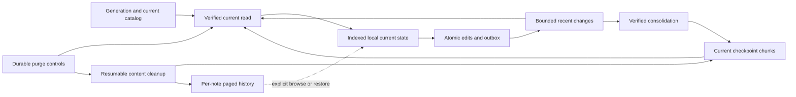

# SPEC-010: Vault checkpoints, deletable history and Trash expiration

## Metadata

| Field | Value |
|---|---|
| Status | Draft for independent review; implementation is not approved |
| Owner | Project maintainer |
| Reviewer | To be assigned by the maintainer |
| Date | 2026-11-01 |
| Decision | [ADR-062](../decisions/062-vault-checkpoints-and-deletable-history.md) (Proposed) |
| Related Plan | [PLAN-011](../plans/011-vault-checkpoints-and-deletable-history.md) (Draft) |

## Summary

Separate the currently usable dataset from retained history. Incremental synchronization and verified checkpoints
let a device obtain current notes without replaying all previous versions. Permanent deletion removes payloads
without invalidating current causality. A future Trash deadline applies to the whole note and its history, never
to the age of an individual version. Old test data is reset explicitly rather than migrated.

The U table records confirmed scope. All F requirements, D defaults and algorithms below describe a proposed
contract for review. They are not implemented behavior, performance evidence or authorization to erase data.
Here, vault means the note dataset, not OS credential storage.

## Goals

- Make cold bootstrap, ordinary local use and reconnection independent of total retained-history volume.
- Preserve concurrent branches, device-local unsaved changes, attachments and account isolation.
- Make deletion durable across retries, offline replicas, stale checkpoints and backup restore.
- Define measurable capacity, recovery and completion boundaries for every supported host.

## Non-Goals

- No automatic age/count retention for individual versions of a live note.
- No migration, automatic conversion or compatibility layer for the old test vault/backup formats; JSON stays V1.
- No new server, globally ordered clock, Drive-wide transaction, remote wipe of offline devices or modification of
  exported backups owned by the user.
- No new PM/agent lifecycle UI, desktop interaction redesign or automatic incremental-backup product.
- No claim of fixed completion time for transferring arbitrary bytes or removing arbitrary cloud data.

## Requirements

### Confirmed user requirements (U)

| ID | Requirement |
|---|---|
| U01 | Remove the permanent inability to delete note-version content; a substantial vault/schema redesign is acceptable |
| U02 | Do not design migration of existing data; provide a way for the new app to explicitly reset old Work Fleet data in Google Drive |
| U03 | A new environment signing into an account with a large history must become usable efficiently |
| U04 | Increasing history must not make normal actions slow; the user explicitly allowed extra time for restoring a very old note version |
| U05 | Future automatic expiration concerns the whole note after it enters Trash; do not calculate retention for each version |
| U06 | Prepare ADR/SPEC/PLAN based on incremental synchronization, consolidated current snapshots and separate history; obtain external review before implementation |

Full-history export and physical cleanup have unavoidable volume-dependent work. Allowing those jobs to run in the
background while foreground actions remain quick is a **proposal**, not a new exception already accepted under U04.
Resolve Q06 before claiming that the design meets the user's complete performance expectation.

### Proposed functional requirements

| ID | Requirement |
|---|---|
| F01 | Bind every remote record, reservation, cursor, maintenance job and reply to a verified account, vault generation and current session; reject stale results before local publication |
| F02 | Bootstrap from bounded current-state discovery, verified chunks and a bounded recent tail; do not enumerate historical descriptors or fetch historical payloads/attachments |
| F03 | Current state includes all unresolved note/group heads, necessary group/redirect summaries and causal evidence; it can be read and edited without historical bodies or a walk through all old group merges |
| F04 | A local save commits changed entities, unsaved-change consumption, outbox and required references atomically; work and bridge transfer must not scale with all stored history |
| F05 | A remote content record is acknowledged only after its immutable bytes and required new attachments are verified; replay uses the same persisted operation/file identities |
| F06 | Consolidation publishes verified current chunks and exact coverage before retiring inputs; retain uncovered concurrent changes and all unresolved heads |
| F07 | Bound delta replay, checkpoint/catalog discovery, active writers and maintenance queues by explicit engineering limits; when a bound is reached, reconcile or pause dependent remote publication with the local work kept |
| F08 | A returning device may abandon excessive feed replay only through a verified current reconciliation; it must not skip deletion controls, discard its outbox, invent success or overwrite a concurrent branch |
| F09 | Browse history by entity and stable bounded pages; restore a selected retained version as a new current revision that observes the previewed heads; a stale preview is rejected |
| F10 | Treat Trash as an application lifecycle state with a unique episode; restoration cancels that episode and re-entry creates another; unrelated edits do not restart its clock |
| F11 | Automatic cleanup acts only on eligible expired Trash episodes after online revalidation; an unknown clock, unresolved eligibility or unavailable executor delays cleanup rather than pretending it ran |
| F12 | Journal a permanent purge decision before deleting content; duplicates and restart are idempotent, and a later reset cannot redirect the job into a different generation |
| F13 | Readers and publishers enforce purge barriers before accepting content, checkpoints, retries, history restoration or old backup identities; absence alone is not a valid purge decision |
| F14 | Cleanup removes every app-managed content copy in its declared scope, including old snapshots, history packs, deltas and attachment references; retain unrelated notes sharing a chunk |
| F15 | Distinguish local request, remotely committed logical purge, physical cloud cleanup, and device acknowledgements; report pending/failed work accurately and keep foreground operations responsive |
| F16 | Recognize an incompatible old vault without parsing its history, preview the exact reset scope, persist the reset plan, and allow safe resume; no automatic reset on sign-in |
| F17 | Preserve the prepare/ready integrity boundary and deterministic account/generation starter group; an intentionally empty initialized workspace stays empty |
| F18 | Backups declare their current and historical coverage; validation, restore, encryption, unsaved changes and layout remain portable and explicit; cached subsets never silently claim all retained history |
| F19 | Use bounded, account-scoped storage/transport operations on all five native platforms and the browser; credentials and generic SQL/HTTP access remain unavailable to the renderer |
| F20 | Product wording comes from en/zh-TW catalogs and native tables; normal UI exposes progress, conflicts and recovery choices, not checkpoint IDs or tuning controls |

### Proposed defaults (D)

These are choices for review, not additional user confirmations.

| ID | Proposed choice |
|---|---|
| D01 | Full changed-entity values in incremental records; immutable, reusable current-state chunks and separate paged history |
| D02 | Entity-scoped dotted causal summaries; explicit incarnation identity per writer, with a separately verified checkpoint coverage frontier |
| D03 | A committed whole-note purge is terminal for that note identity; a concurrent/unseen restore or edit cannot resurrect it; preserve unpublished local work for explicit Save as copy |
| D04 | Propose Delete version for historical non-head versions, Delete forever for a trashed note, and Empty Trash over the exact previewed note/episode set; manual feature scope awaits Q05 |
| D05 | For cloud Trash, prefer a verified cloud-time anchor when the episode is first confirmed remotely; show offline deletion as pending. No device clock alone may authorize early cloud purge. Q04 resolves the user-visible timing policy |
| D06 | Any capable online client may run idempotent expired-note cleanup; no permanent leader and no guarantee of execution while all clients are off/suspended |
| D07 | Remote attachments initially belong to one note identity, deduplicated by hash within that note; cross-note sharing requires a separate proven reference protocol |
| D08 | Startup obtains current text/conflicts and attachment metadata; bytes load on demand. Cache eviction affects local availability, not remote history retention |
| D09 | New-generation readiness can precede completion of old-generation physical cleanup; expose both states and never label a pending cleanup complete |

## Design Overview

### Logical records and boundaries

The following fields define required information, not a frozen JSON wire schema. Closed envelopes, canonical
encoding, quotas and concrete file queries must be completed under Q01/Q02 before implementation.
All new public JSON schemaVersion values remain 1; incompatible layouts have an explicit format/capability marker.

| Record | Required information |
|---|---|
| Vault control | Format/capabilities, opaque dataset/generation identity, initialization plan/receipt and bounded current catalog references |
| Entity change | Operation and entity identity, writer incarnation/dot, observed causal context, full value, attachment references and history identity |
| Checkpoint manifest | Checkpoint/shard identity, source candidates, exactly covered stream prefixes, current chunk descriptors/digests and required control references |
| Current chunk | Complete current values and every unresolved head for its partition, causal summaries, Trash episodes and required group references; no all-history ID list |
| History index/page | Entity identity, index generation, stable page cursor and retained revision locators/digests; purged entries are distinguishable from corruption |
| Trash episode | Episode ID, note identity, originating operation, time anchor/status, policy revision and effective deadline |
| Purge barrier | Purge operation, generation, note identity or explicit revision targets, triggering episode/observed heads and cleanup scope; no content/title/attachment bytes |
| Maintenance journal | Account/generation, exact targets and coverage, stage, persisted reservations, completion receipts and retry state |
| Local unsaved record | ADR-061's one set of unsaved changes, with sufficient baseline data/proof to compare current content without downloading old history |

Remote file IDs, OAuth state, source cursors and upload sessions do not become portable backup identities.
Historical timestamps can order a display; they cannot choose a winner or prove causality. A missing required chunk
is an error, whereas an authorized purged historical version is intentionally unavailable.

### Bootstrap and long-offline reconciliation

1. Verify the account and current generation. Recognize an incompatible layout or an incomplete initialization
   before projecting its content; a legacy-format prompt does not trigger a history download.
2. Capture a changes start point before current discovery. Enumerate only current catalog candidates and required
   control data, with pagination/incomplete-list checks. Fetch the bounded checkpoint manifest/chunks and current
   unresolved heads. Never choose an incomparable candidate merely because its timestamp or ID is larger.
3. Stage and verify the captured coverage, hashes, required references and applicable purge controls. Fetch content
   only for current heads; missing old ancestors do not block valid current data.
4. Reconcile changes since the captured start point. Changes is an account/app-data feed without a history-kind
   filter, so enforce a catch-up work budget. Restart current reconciliation safely when it is exceeded; preserve
   the prior local state and unsaved/outbox work. Repeated overload shows pending sync rather than a false success.
5. Activate a verified current baseline, its controls and cursor atomically. Any later-arriving publication remains
   eligible for incremental sync. Completion is relative to the verified feed/coverage boundary, not a promise that
   every offline device has uploaded everything.
6. Reconcile this device's outbox against the current generation, heads and purge barriers before publishing it.
   Missing entities without a purge proof need investigation; do not silently delete local data or resurrect them.

The implementation must prove that listing and publication races cannot permanently omit a committed current
change. Replacing a cursor with "now" or assuming a Drive listing is a multi-file snapshot does not prove this.
Q01 also requires a progress strategy under sustained writes; endless restart is not accepted as efficient startup.

### Publication, consolidation and collection

- Persist local operation identity and dependencies before network work. Upload/verify required attachments,
  history representation and current data before publishing the commit receipt. A crash leaves replayable work,
  not an acknowledged revision whose only body existed in a removed tail.
- Consolidation captures a defined input set. Its manifest records exact covered prefixes without holes. Write new
  immutable chunks, verify them, then publish the candidate and a completion receipt.
- A successor may reuse unchanged chunks. Concurrent incomparable checkpoints and uncovered tail operations remain
  discoverable until a verified successor covers their semantics, including conflicts and deletion knowledge.
- Retiring a checkpoint or delta requires both replacement coverage and durable retained history, unless a purge
  authorizes its removal. An offline device's acknowledgement is not required forever: it can rebootstrap and must
  retain/reconcile its unpublished work independently.
- Catalog maintenance, writer retirement and purge-control compaction need explicit bounded protocols. No startup
  path may enumerate all retired checkpoints, purged notes or historical writer events.
- Before a shared chunk is deleted, publish verified replacement chunks for its surviving content and fence old
  references. Keep deletion evidence long enough for a reader to distinguish collection from corruption. Stale
  checkpoints cannot restore a purged note or pin its bytes indefinitely.

Q01 is a blocking proof obligation for the physical catalog/reference protocol. These rules do not claim that
create-only files, metadata updates, a clock-based lease or an unverified conditional PATCH already solve it.

### History and manual version removal

History browsing reads a bounded page for the selected entity and preserves branches. A direct selected revision
fetch does not require traversing unrelated notes. Index publication and deletion are restart-safe; an old cursor
can refresh instead of silently returning the wrong version. Deep history work is cancellable.

Under proposed D04, only non-head historical revisions are selectable for removal. A version still needed by an
unsaved edit, in-flight restore/export or unresolved conflict is identified explicitly. A temporary reader may need
to be cancelled or materialize a safe independent baseline; it cannot silently pin deleted cloud content forever.
Manual removal uses a revision-specific barrier and rewrites only affected history packs/index paths. It never
implies automatic version retention and does not erase equal text that remains in other retained versions.

Group history uses the same lazy storage boundary, but this proposal adds no automatic group purge. Current group
redirects, membership and unresolved cycles remain represented without replaying all historical group revisions.

### Trash and permanent purge

The lifecycle is `active -> trashed(episode) -> purge committed -> cleanup pending -> cloud cleanup confirmed`.
Restoring before a purge commits returns to active and cancels that observed episode. Local requests and unconfirmed
network outcomes are not equivalent to a committed cloud decision.

An expiry worker reads an indexed deadline queue/current Trash state, not every historical revision. It revalidates
the generation, episode, effective policy, clock and observed heads before publishing a purge. An observed restore
or unresolved eligibility prevents automatic cleanup. A competing restore that the purger has not observed is
handled by proposed D03, not by guessing which device clock was later; Q03 must approve that rule.

Changing the Trash period cannot silently rewrite old deadlines. Q04 decides whether changes apply only to future
episodes or require a preview for existing ones. There is no chosen number of days yet. Local-only workspaces use
the same lifecycle, but their clock-skew/restart policy must be defined separately from cloud confirmation.

Purge processing is durable and idempotent:

1. Persist exact scope and operation identity, then publish/verify its content-free barrier. Recheck the generation
   around every externally visible stage. Concurrent workers deduplicate the logical decision.
2. Remove the identity from normal current projection; block pending uploads/retries and stop new references to its
   data. Keep distinct unpublished local edits in explicit recovery state, not in the synced note/history.
3. Sanitize current chunks and indexes, remove retained history/deltas/obsolete chunk copies, and reclaim blobs only
   when their ownership and live references permit it. Bound each work slice and favor foreground save/sync.
4. Record confirmed cloud cleanup only after all known in-scope app-managed copies are handled and publication races
   are reconciled. A failed request remains pending; 404 alone without account/generation validation is not proof.
5. Receiving devices invalidate their cached history, previews, layout/undo references and now-unused attachments.
   An offline device cannot acknowledge cleanup until it reconnects. Data kept solely as unpublished recovery work
   is disclosed separately; never claim all copies everywhere were erased.

Deletion barriers are indexed by identity and partitioned, so current bootstrap does not load every past purge.
Garbage collection cannot remove the last anti-resurrection evidence while stale identities can still be accepted.
Restore/export readers and compaction jobs must have cancellation/revalidation semantics when purge intervenes.

### Reset of old data and initialization

The preview identifies the verified account, Work Fleet app-data scope, affected old generation/layout and local
unsynced data. Ordinary Drive files and other account partitions are excluded. Legacy payloads need not decode;
use validated metadata/IDs for deletion. An unreadable old format cannot require a successful new-format safety
backup as a prerequisite: offer export with a compatible old app where available and explicit informed reset.
This is distinct from overwriting a readable current vault, whose applicable safety-backup requirements remain.

Persist `prepare -> isolate generation -> initialize current -> ready -> clean old scope -> complete` stages and
reservations. D09 allows ready before old cleanup completes. The deletion target must remain the original scope;
resumption never expands to "everything in appDataFolder" after new data has been created. Later generations fence
old jobs permanently. Duplicate or conflicting initialization plans cannot be resolved by choosing the first file.

Followers verify the generation's current manifest/receipt before activation and do not each create a starter
group. A backup restore has separate current-readiness and full-restore completion receipts if history upload
continues afterward; it cannot claim the complete restore finished early.

Unsupported older clients with the same grant cannot be prevented by a client protocol from uploading arbitrary
files. Require updating/stopping them and isolate incompatible writes; do not claim a metadata field is a server
access-control boundary. Existing local data is preserved until an explicit local reset/rejoin decision.

### Backup and restore implications

Specify a pinned logical capture boundary and an explicit list/range of included history in the revised V1 backup
manifest. A snapshot plus cache is not automatically a complete retained-history export. The product must distinguish
complete retained history from an explicitly selected known-local subset, including unavailable attachment bytes.
Q06 chooses the default and reconciles the existing 20,000-entry / 128 MiB expanded ZIP limits with large history.

The exported artifact remains self-contained for its declared scope, without dependency on an older backup file.
Keep unsaved changes and device layout under ADR-061, strict validation, encryption and atomic local application.
No provider file IDs, tokens or source cursor become portable state. Full-history download/export is streamed or
staged under explicit capacity limits; never truncate silently or claim a complete export after cancellation.

Ordinary merge, visible-state replace and history recovery consult current purge barriers and preview blocked
identities. Explicit Import as new may recover chosen content under new IDs with clear disclosure. Full local/cloud
replacement is an explicit generation reset with its own preview; it is not an unnoticed bypass of deletion rules.
Previously exported files are not rewritten or deleted by a note purge. A purge racing with export/restore requires
revalidation, cancellation or a clearly identified earlier capture, not accidental resurrection during commit.

## Non-Functional Requirements

### History-independent foreground work

Let N be current entities (including Trash and conflicts), H retained history bodies, W writer metadata, B the
configured tail/discovery budget, and K the requested history page. Current payload sizes and attachments are
separate variables. The requirement is independence from H, not constant time for arbitrarily large N or content.

| Operation | Required work boundary |
|---|---|
| Cold bootstrap / lost cursor | Current chunks and necessary controls, proportional to N/W plus bounded B; zero historical payload or all-history descriptor scan |
| Warm open, edit/save, current search, desktop operations | Indexed current/affected local records; no full-history copying, encryption, bridge transfer or graph rebuild |
| Ordinary sync | Affected current records/control checks and new attachment bytes; no historical ancestry fetch |
| Long-offline reconnect | Bounded catch-up or verified current reconciliation; no replay proportional to years of missed history |
| History first page / selected version | Bounded K/index navigation for that entity; no all-account history scan |
| Trash eligibility / purge submission | Indexed current episodes and a bounded durable command; physical cleanup proceeds separately |
| Consolidation | Affected current chunks and covered tail; no scan of H, no deletion of retained history merely because it was checkpointed |
| Complete-history export, old-format reset, physical purge | Volume-dependent background work with progress/cancellation/resume; proposed U04 qualification subject to Q06 |

Test fixed N/current bytes/W/conflicts with H = 10,000, 100,000 and 1,000,000. Instrument provider requests, listed
descriptors, downloaded bytes, history reads, records touched, serialized/bridge bytes, memory, and p50/p95 latency.
Deterministic tests must reject forbidden history work even if a fast test machine hides its latency. Also vary
deleted identities, stale checkpoints, writer incarnations, feed backlog and deep group redirects independently;
they must not become substitute unbounded startup histories.

Finite budgets and absolute user-visible latency targets on named minimum devices/network conditions must be agreed
under Q07 before performance acceptance. No numerical throughput or wall-clock result is established by this draft.
Large attachments still cost their transfer size; network outages and quota backoff cannot be called instant success.

### Other boundaries

- Persisted acknowledgements remain durable across process death; pending local work survives cloud failures.
- Hashes and strict JSON checks detect corruption, not trustworthy authorship or permission to execute content.
- Cancellation and account switching fence late work; logs contain no content, credentials or upload-session URLs.
- Native file/database operations stay within the current account and existing grants; no broader Drive scope.
- Real Drive, native storage and mobile background execution require their own evidence, separately from model tests.

## Acceptance Cases

These are required future cases, not passing tests. PLAN-011 maps them to implementation phases.

| ID | Scenario | Expected result |
|---|---|---|
| VC01 | Fixed current data with increasing H | Bootstrap performs no history-body read or all-history listing; recorded work obeys the agreed budget |
| VC02 | Save, current search and desktop operation with a large local history | No whole-history serialization, bridge transfer or ancestry rebuild |
| VC03 | Cold bootstrap during writes and listing pagination | Every committed current change remains discoverable; no early success or missing branch |
| VC04 | Two devices consolidate overlapping/incomparable input | Both semantic results survive; only proven covered inputs retire |
| VC05 | Crash/lost response at each publication and retirement boundary | Replay is idempotent; no acknowledged content/history lost and no unbounded discovery leak |
| VC06 | Missing current chunk, bad digest, duplicate ID with different bytes | Keep prior state and fail the affected operation; do not treat corruption as purge |
| VC07 | Very old or missing cursor with huge change feed | Bounded reconciliation preserves pending edits and deletion knowledge; never jumps cursor alone |
| VC08 | Offline concurrent edits after old payloads were purged | Causal summaries preserve real conflicts without downloading deleted ancestors |
| VC09 | Writer clone, restored backup, or long succession of devices | No dot reuse, false causality or unbounded mandatory writer-event replay |
| VC10 | Browse and restore an old version while other notes have huge histories | Only selected-entity pages/body are read; stale heads reject restoration |
| VC11 | Delete a historical non-head version under proposed D04 | Current heads and other retained versions work; repeated requests do not restore the deleted version |
| VC12 | Requested version is a current/conflict head or used by an in-flight job | Refuse or explicitly resolve the dependency; no hidden data loss or indefinite purge pin |
| VC13 | Trash, restore, trash again; edit unrelated metadata | Distinct episodes; only the intended deadline applies |
| VC14 | Clock skew, offline trash, policy change, all clients off | No early purge from a bad clock; pending timing/cleanup remains truthful under approved Q04 |
| VC15 | Two expiry workers and a concurrent restore/edit | Deterministic approved Q03 outcome; no same-identity resurrection; unpublished work remains recoverable |
| VC16 | Purged content exists in shared/retired chunks and history packs | Sanitize all in-scope copies without losing neighboring notes; stale references cannot reintroduce it |
| VC17 | Attachment reuse, new upload and cleanup race | No live/pinned blob removed; cleanup does not scan all account history to guess references |
| VC18 | Offline device reconnects after purge | Old cache/outbox/undo cannot resurrect the note; explicit Save as copy handles distinct unpublished work |
| VC19 | Many old tombstones, stale checkpoints and deep retired-group chains | Current discovery remains bounded; deletion and group semantics remain correct |
| VC20 | New app sees old or unsupported V1 vault payloads | Offers explicit reset without history parsing; sign-in alone changes/deletes nothing |
| VC21 | Reset crashes, loses replies or is superseded; old client writes | Exact old scope resumes safely; no later-generation deletion or old-data ingestion |
| VC22 | Six devices join a new/reset generation, including an empty one | One logical initialization; receipt verified, no duplicate starter, no half-ready projection |
| VC23 | New device exports before history/attachments are cached | Coverage is explicit; complete mode retrieves/validates all declared data or fails without omission |
| VC24 | Old backup merge/replace, explicit import, and purge during export/restore | Current deletion rules and capture boundary respected; only explicit new identities recover purged content |
| VC25 | Account switch or native commit failure during any new operation | Atomic rollback/reconciliation and correct account fencing; no false durable ack |
| VC26 | Slow cleanup/consolidation with active editing on every host | Foreground budgets hold; bounded progress, retry/cancel and resume survive process death |

## Open Questions

These are approval/proof gates for the reviewer and maintainer. They do not reopen U01-U06.

| ID | Question and proposed starting point | Blocks |
|---|---|---|
| Q01 | Can the immutable candidate/receipt catalog, bounded tail, reference retirement and collection protocol meet concurrency and progress invariants on real Drive without assumed CAS? Specify concrete queries/records and prove them before freezing the wire format | Remote publication, bootstrap and deletion implementation |
| Q02 | Validate dotted entity summaries, separate stream coverage, baseline comparison and writer retirement; define finite metadata/capacity limits without inventing causality | Revision/checkpoint codec and conflict implementation |
| Q03 | Approve or revise terminal purge precedence over an unseen restore/edit, and how distinct unpublished work is presented for Save as copy | Whole-note purge and expiry behavior |
| Q04 | Choose Trash days/configurability, cloud versus offline time anchor, policy-change behavior and local-only clock rules; no per-version retention | Automatic expiration; schema retains episode/policy fields now |
| Q05 | Confirm manual Delete version / Delete forever / Empty Trash scope and pinned-version handling; these UI operations were suggested, not individually confirmed | Manual deletion UI and protected-version rules |
| Q06 | Approve the background completion boundary for full-history export/reset/cleanup; choose explicit backup coverage defaults and a large-data capacity/container strategy | Full performance claim and new backup/restore contract |
| Q07 | Set hard tail/catalog/writer/work-queue limits, chunk sizes and absolute latency targets for named devices/network; prove a safe overload path | Performance acceptance and provider tuning |

## Dependencies and References

- [ADR-062](../decisions/062-vault-checkpoints-and-deletable-history.md),
  [PLAN-011](../plans/011-vault-checkpoints-and-deletable-history.md),
  [dated evidence](../research/2026-11-01-drive-vault-checkpoints-and-deletion.md)
- [SPEC-004](004-revision-graph-and-file-sync.md), [SPEC-002](002-portable-backup-and-restore.md),
  [SPEC-008](008-workspace-initialization.md): existing contracts; proposed replacement scope is in ADR-062
- [SPEC-007](007-schema-evolution-and-migrations.md),
  [ADR-061](../decisions/061-unsaved-changes-instead-of-drafts.md): V1 and device-local unsaved work
- [Testing](../testing.md), [Google setup](../google-setup.md), [security](../security-guidelines.md)

Created: 2026-11-01. Independent review and implementation approval are pending.
